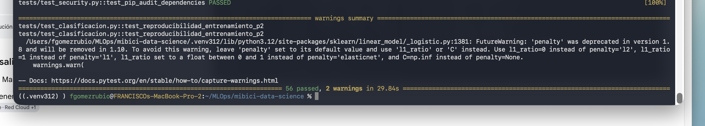
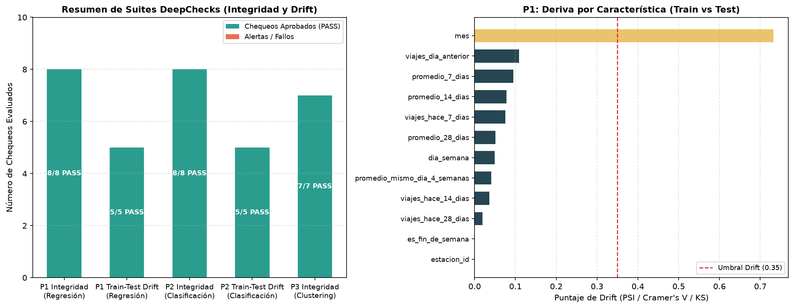

# MiBici Data Science

**Proyecto integrador — Equipo 36 | Maestría, materia: Operaciones de Aprendizaje Automático (MLOps)**

[](https://cookiecutter-data-science.drivendata.org/)

**Integrantes:**
- Francisco Gómez Rubio A00710437 **GitHub Maintainer**
- Carolina Nicole González Leal A01284948 **ML Engineer (P1)**
- Alan Ortiz González A01840596 **ML Engineer (P2)**
- Alan Ricardo González Aguilar A01633872 **ML Engineer (P3)**

Repositorio de trabajo colaborativo para organizar, validar y posteriormente analizar datos abiertos de viajes del sistema MiBici. El proyecto utiliza la estructura de **Cookiecutter Data Science** y busca mantener separados el código versionado y los datos originales.

**Repositorio:** https://github.com/maestria-mlops-equipo36/TC5061-Proyecto-Equipo36

## 1. Datos utilizados

El equipo trabaja con **142 archivos CSV mensuales**, desde **diciembre de 2014 hasta septiembre de 2026**, que ocupan aproximadamente **2.9 GB**. Los datos originales se obtienen del portal de [datos abiertos de MiBici](https://mibici.net/es/datos-abiertos/) o de la carpeta compartida que facilite el equipo.

**Los CSV no están incluidos en GitHub.** Cada integrante debe disponer de una copia local o de una carpeta de OneDrive sincronizada en su computadora. No es necesario moverlos a `data/raw/`: los scripts leen la ubicación indicada en `MIBICI_DATA_DIR`.

Todos los archivos mensuales deben estar directamente en una misma carpeta, con nombres como:

```text
datos_mibici/
├── datos_abiertos_2014_12.csv
├── datos_abiertos_2015_01.csv
├── ...
└── datos_abiertos_2026_09.csv
```

Si el equipo utiliza OneDrive, solicitar a otro integrante el acceso a la carpeta compartida; el repositorio **no** concede automáticamente acceso a OneDrive.

## 2. Clonar el repositorio

En una terminal de Windows (CMD, PowerShell) o macOS:

```bash
git clone https://github.com/maestria-mlops-equipo36/TC5061-Proyecto-Equipo36.git
cd TC5061-Proyecto-Equipo36
```

Se recomienda utilizar una versión de Python compatible con las dependencias del proyecto. Los experimentos documentados se ejecutaron con **Python 3.12** en el entorno local `.venv312` y MLflow 3.17.1. Se recomienda Python 3.12 y verificar las versiones efectivas de `requirements.txt` antes de reproducir las corridas.

## 3. Crear el entorno virtual e instalar dependencias

### Windows — CMD

```cmd
py -m venv .venv
.venv\Scripts\activate
python -m pip install --upgrade pip
python -m pip install -r requirements.txt
```

### macOS — Terminal

```bash
python3 -m venv .venv
source .venv/bin/activate
python -m pip install --upgrade pip
python -m pip install -r requirements.txt
```

La carpeta `.venv` es local y no se comparte por Git. Cada integrante debe crear su propio entorno virtual. Para salir de él: `deactivate`.

## 4. Configurar la ubicación de los datos

En la **raíz del repositorio** (junto a `README.md`), crear un archivo llamado `.env` con la variable `MIBICI_DATA_DIR`.

**Windows — ejemplo:**

```dotenv
MIBICI_DATA_DIR=C:/Users/usuario/OneDrive/Operaciones ML/datos_mibici
```

**macOS — ejemplo:**

```dotenv
MIBICI_DATA_DIR=/Users/usuario/Library/CloudStorage/OneDrive-Institucion/Operaciones ML/datos_mibici
```

Estas rutas son **ilustrativas**: sustituirlas por la ubicación real de la carpeta en cada equipo. Se recomienda usar `/` incluso en Windows para evitar problemas de escape en rutas. Si se usa OneDrive, asegurarse de que los CSV estén descargados y disponibles localmente.

El archivo `.env` está excluido mediante `.gitignore`: **no debe subirse a GitHub** ni contener tokens o contraseñas.

## 5. Ejecutar los procesos disponibles

Ejecutar desde la raíz del proyecto, con el entorno virtual activado.

### 5.1 Inventario de archivos mensuales

```bash
python -m mibici.dataset
```

Identifica los archivos CSV disponibles y genera:

```text
data/interim/inventario_mibici.csv
```

### 5.2 Validación de encabezados

```bash
python -m mibici.validate_schema
```

Revisa los nombres de columnas de los archivos mensuales y genera:

```text
data/interim/validacion_esquemas.csv
```

En la revisión inicial se verificaron **142 archivos** y se obtuvo correspondencia de esquemas después de normalizar variaciones de codificación en el encabezado `Año_de_nacimiento`. **Esta validación no implica que los valores de todas las filas sean correctos**; la calidad de los registros se analizará por separado.

### 5.3 Ingesta consolidada y versionado de datos

Ejecuta el pipeline de ingesta reproducible para descargar la nomenclatura, procesar los 12 meses seleccionados (octubre 2025 a septiembre 2026), exportar a Parquet y generar el manifiesto de datos con hashes SHA-256 (`data/data_manifest.json`):

```bash
python -m mibici.dataset
```

### 5.4 Ingeniería de características (Feature Engineering P3)

Calcula los vectores de comportamiento por estación (ratios de flujo neto, porcentajes en horas pico matutina y vespertina, rotación de anclajes y uso en fines de semana):

```bash
python -m mibici.features
```

Genera:
- `data/processed/features_p3_estaciones.parquet`

### 5.5 Servidor de MLflow y entorno de ejecución

Los tres problemas comparten el experimento de tracking **`mibici-equipo36`**. El servidor utilizado durante las pruebas estuvo disponible en `http://127.0.0.1:5000`, con base SQLite y artefactos locales gestionados fuera del repositorio. **Los runs no se suben automáticamente a GitHub**.

En macOS, desde la raíz del proyecto, con el entorno `.venv312` ya creado e instaladas las dependencias:

```bash
.venv312/bin/python -m pip show mlflow
export MLFLOW_TRACKING_URI=http://127.0.0.1:5000
```

Iniciar por separado el servidor de MLflow configurado para el curso. Si se usa un servidor propio, asegurar que backend store y artefactos estén configurados de forma persistente; ejecutar simplemente `mlflow ui` podría abrir un almacén diferente del utilizado por las corridas.

### 5.6 P1 — Regresión: viajes por estación y día

**Pregunta:** ¿Cuántos viajes se iniciarán en una estación o zona en un periodo futuro?

El objetivo es predecir la demanda diaria por estación, usando características históricas y división temporal. Se comparan un modelo de referencia y Random Forest.

```bash
# Referencia
MLFLOW_TRACKING_URI=http://127.0.0.1:5000 env -u PYTHONPATH \
  .venv312/bin/python -m mibici.modeling.train \
  p1-regresion --modelo-tipo baseline

# Candidato
MLFLOW_TRACKING_URI=http://127.0.0.1:5000 env -u PYTHONPATH \
  .venv312/bin/python -m mibici.modeling.train \
  p1-regresion --modelo-tipo random_forest
```

**Evidencia observada:** `P1_baseline` y `P1_random_forest` aparecen en la interfaz de MLflow. El baseline obtuvo MAE=6.5527 y RMSE=10.7318 en validación, y MAE=8.5673 y RMSE=14.7710 en prueba. Las figuras del candidato muestran reales frente a predichos, importancia de características y distribución de errores. Los valores numéricos del candidato deben consultarse en su run antes de afirmar una mejora cuantitativa.

### 5.7 P2 — Clasificación: riesgo en estación

**Pregunta:** ¿Una estación estará en riesgo de quedarse sin bicicletas o sin anclajes disponibles en un periodo futuro?

Se ejecutan `DummyClassifier` como referencia y `LogisticRegression` como candidato. La interpretación operativa depende de cómo se definió la etiqueta de riesgo (real o proxy).

```bash
MLFLOW_TRACKING_URI=http://127.0.0.1:5000 env -u PYTHONPATH \
  .venv312/bin/python -m mibici.modeling.train_p2
```

**Evidencia observada:** runs `P2_Baseline_DummyClassifier` y `P2_Candidato_LogisticRegression`; candidato con F1 macro≈0.6910 y ROC AUC≈0.8652 en la ejecución mostrada. La matriz de confusión adjunta registra VN=126615, FP=26691, FN=5527 y VP=16262. Se generan una curva ROC y una matriz de confusión. Para reproducibilidad se debe comprobar que el código, la etiqueta y los datos coincidan con la versión evaluada.

### 5.8 P3 — Clustering: perfiles de estaciones

**Pregunta:** ¿Qué grupos de estaciones comparten patrones de uso y dónde se ubican en la ciudad?

Las características por estación se obtienen con:

```bash
env -u PYTHONPATH .venv312/bin/python -m mibici.features
```

Modelos comparados:

```bash
MLFLOW_TRACKING_URI=http://127.0.0.1:5000 env -u PYTHONPATH \
  .venv312/bin/python -m mibici.modeling.train --modelo-tipo kmeans --n-clusters 3

MLFLOW_TRACKING_URI=http://127.0.0.1:5000 env -u PYTHONPATH \
  .venv312/bin/python -m mibici.modeling.train --modelo-tipo kmeans --n-clusters 4

MLFLOW_TRACKING_URI=http://127.0.0.1:5000 env -u PYTHONPATH \
  .venv312/bin/python -m mibici.modeling.train --modelo-tipo gmm --n-clusters 4
```

Se comparan perfiles y mapas de clusters; los indicadores internos incluyen silhouette, Davies-Bouldin y Calinski-Harabasz. La ejecución GMM debe verificarse en la lista de runs de la instancia usada.

#### 5.8.1 Referencia adicional por reglas de intensidad

Se incorpora una referencia sencilla que agrupa las estaciones según
`viajes_diarios_por_anclaje`:

- Uso bajo: valores menores o iguales al percentil 33.
- Uso medio: valores mayores al percentil 33 y menores o iguales al percentil 67.
- Uso alto: valores mayores al percentil 67.

Los umbrales se calculan a partir de las estaciones del archivo de entrada.
Esta referencia complementa el análisis; K-Means con k=3 se mantiene como
baseline oficial del proyecto.

##### Ejecución

Con el entorno del proyecto activo y desde la raíz del repositorio:

```bash
MLFLOW_TRACKING_URI=http://127.0.0.1:5000 env -u PYTHONPATH \
  .venv312/bin/python -m mibici.modeling.baseline_reglas
```

Se requiere el archivo `data/processed/features_p3_estaciones.parquet`,
generado mediante `.venv312/bin/python -m mibici.features` después de la ingesta.

##### Evaluación y registro

Las agrupaciones se evalúan sobre las mismas siete características
estandarizadas utilizadas por la configuración espacial de K-Means:
flujo neto, salidas en pico matutino, salidas en pico vespertino, salidas
en fin de semana, viajes diarios por anclaje, latitud y longitud.

Se registra la ejecución `P3_reglas_intensidad_k3_espacial` en el experimento
de MLflow configurado para el proyecto. Se guardan los umbrales, las
métricas, el número de estaciones por grupo y dos artefactos:
`estaciones_niveles.csv` y `metricas.json`.

##### Resultados observados

La referencia por reglas produjo 160 estaciones de uso bajo, 164 de uso
medio y 160 de uso alto. Los umbrales fueron aproximadamente 0.9913 y
3.3040 viajes diarios por anclaje.

| Métrica | Referencia por reglas | K-Means k=3 |
|---|---:|---:|
| Silhouette — mayor es mejor | 0.0592 | 0.2323 |
| Davies-Bouldin — menor es mejor | 4.5544 | 1.3457 |
| Calinski-Harabasz — mayor es mejor | 32.27 | 117.79 |

Los valores de K-Means corresponden a la ejecución previamente validada.
La comparación requiere utilizar el mismo conjunto de estaciones y las
mismas características y transformación.

K-Means obtiene mejores métricas internas que la regla de intensidad.
Estas métricas describen la estructura de los grupos, pero no demuestran
por sí solas su utilidad operativa. Los percentiles tampoco garantizan
grupos de igual tamaño cuando existen valores repetidos.

### 5.9 Verificación de runs y evidencias para evaluación

En MLflow abrir el experimento `mibici-equipo36` y comprobar al menos un run **por cada P1, P2 y P3**. Para cada run verificar: parámetros, métricas, etiquetas, artefactos y origen del código. Capturar cuatro evidencias legibles: (1) lista de runs con los tres problemas; (2) parámetros y etiquetas; (3) métricas; (4) artefactos y modelo, cuando aplique. Una captura de terminal demuestra ejecución, pero no sustituye las pestañas de MLflow.

> **Importante:** las instrucciones reflejan ejecuciones compartidas por el equipo, pero la presencia actual de cada script y run en `main` debe verificarse en GitHub. Los archivos ignorados (datos, modelos, credenciales y tracking) no deben agregarse para aparentar que están versionados.

### 5.10 Model Registry y ciclo de vida de los modelos

El proyecto utiliza **MLflow Model Registry** para gestionar los modelos seleccionados de las tres preguntas de negocio (P1, P2 y P3). Cada modelo se registra con un nombre consistente, una versión y metadatos de linaje que permiten relacionarlo con su entrenamiento y los datos utilizados.

Los modelos registrados son:

| Pregunta | Modelo registrado | Alias |
|---|---|---|
| P1 — Regresión | `mibici-equipo36-p1-demanda` | `champion` |
| P2 — Clasificación | `mibici-equipo36-p2-riesgo` | `champion` |
| P3 — Clustering | `mibici-equipo36-p3-grupos` | `champion` |

El alias `champion` identifica la versión seleccionada de cada modelo y permite acceder a ella sin depender de un número de versión específico. Su asignación no implica que exista un servicio de inferencia desplegado.

**Registro de modelos:**

```bash
MLFLOW_TRACKING_URI=http://127.0.0.0:5000 \
python -m mibici.modeling.register_models
```

**Verificación del registro:**

```bash
MLFLOW_TRACKING_URI=http://127.0.0.0:5000 \
python -m mibici.modeling.verify_registry
```

Durante las pruebas locales se verificó el registro de los tres modelos y su carga mediante el alias `champion`.

Para consultar las configuraciones seleccionadas, el proceso de registro, la verificación de firmas y metadatos, y las URI de carga de los modelos, consultar la **sección 15: Model Registry y ciclo de vida de los modelos** en [`docs/README.md`](docs/README.md).

Los modelos registrados y sus artefactos permanecen en el servidor MLflow utilizado durante las pruebas; no se almacenan directamente en GitHub.

### 5.11 Pruebas automatizadas con PyTest

El proyecto incorpora pruebas automatizadas mediante **PyTest** para validar las funciones principales de los tres problemas de negocio, incluyendo casos normales, situaciones límite, integridad de datos y reproducibilidad de los entrenamientos.

Las pruebas se encuentran organizadas en la carpeta `tests/`:

| Archivo | Funcionalidad evaluada |
|---|---|
| `test_data.py` | Validaciones generales de datos, configuraciones y características |
| `test_regresion.py` | P1: demanda diaria, características históricas, validaciones y reproducibilidad de Random Forest |
| `test_clasificacion.py` | P2: cálculo de riesgo, separación temporal, prevención de fuga de información y reproducibilidad de regresión logística |
| `test_clustering.py` | P3: perfiles de estaciones, casos límite, entrenamiento de K-Means y GMM, y reproducibilidad |

#### Ejecución de las pruebas

Desde la raíz del repositorio, con el entorno virtual activado y las dependencias instaladas:

```bash
python -m pytest tests/ -v
```

También es posible ejecutar las pruebas de un problema específico:

```bash
python -m pytest tests/test_regresion.py -v
python -m pytest tests/test_clasificacion.py -v
python -m pytest tests/test_clustering.py -v
```

Las pruebas utilizan principalmente datos sintéticos para comprobar resultados conocidos sin depender de los archivos CSV originales ni de un servidor MLflow activo.

#### Reproducibilidad

Se incorporaron pruebas que entrenan dos modelos independientes utilizando los mismos datos, hiperparámetros y semilla aleatoria (`RANDOM_SEED = 42`).

Se verifica la consistencia de predicciones y métricas en:

- **P1:** Random Forest Regressor.
- **P2:** Logistic Regression.
- **P3:** K-Means y Gaussian Mixture Model.

En clustering, las agrupaciones se comparan mediante el *Adjusted Rand Index*, evitando depender de los números arbitrarios asignados a los clusters.

#### Resultados de ejecución

Las pruebas se ejecutaron localmente utilizando Python 3.12 y PyTest 9.1.1.

**Resultado obtenido:**

```text
56 passed, 2 warnings in 29.84s
```

Las dos advertencias corresponden a la deprecación del parámetro `penalty` de `LogisticRegression` en scikit-learn. No se registraron pruebas fallidas.

Este resultado valida los casos cubiertos por la suite, pero no sustituye las verificaciones de integración completa, calidad de datos reales o seguridad del repositorio.

## 6. Organización del proyecto

```text
TC5061-Proyecto-Equipo36/
├── data/
│   ├── external/         # Datos externos
│   ├── interim/          # Reportes y resultados intermedios (ignorados por Git)
│   ├── processed/        # Datos procesados (ignorados por Git)
│   └── raw/              # Datos originales, si se usan localmente (ignorados por Git)
├── docs/                 # Documentación MkDocs
├── mibici/               # Código fuente del proyecto
│   ├── config.py         # Rutas y variables de entorno
│   ├── dataset.py        # Inventario de archivos CSV
│   ├── validate_schema.py # Validación de encabezados
│   ├── features.py       # Ingeniería de características
│   ├── plots.py          # Visualizaciones
│   ├── modeling/         # Entrenamiento, registro y predicción
│   └── serving/          # Recuperación de modelos en MLflow y API REST (FastAPI)
├── models/               # Modelos generados
├── notebooks/            # Cuadernos Jupyter
├── references/           # Diccionarios y referencias
├── reports/
│   └── figures/          # Figuras de análisis
├── tests/                # Pruebas automatizadas
├── .gitignore
├── Makefile
├── pyproject.toml
├── requirements.txt
└── README.md
```

Los archivos `.gitkeep` conservan la estructura de carpetas vacías. Los datos de `data/`, los entornos virtuales y `.env` no se versionan.

## 7. Trabajo colaborativo con Git y GitHub

El repositorio es **público para consulta**, de modo que el profesor puede revisarlo mediante la URL sin invitación. Solo quienes tengan permisos de escritura en la organización podrán publicar cambios.

Se recomienda trabajar en una rama por tarea, por ejemplo:

```bash
git switch main
git pull origin main
git switch -c feature/validacion-calidad
```

Después de realizar y comprobar cambios:

```bash
git add .
git commit -m "Add data quality validation"
git push -u origin feature/validacion-calidad
```

Abrir un **Pull Request** en GitHub para revisar e integrar los cambios a `main`. Antes de ejecutar `git add .`, comprobar con `git status` que no se incluyan datos, credenciales o archivos personales.

Para actualizar una copia local antes de comenzar una nueva tarea:

```bash
git switch main
git pull origin main
```

**Reglas del equipo:** no subir CSV originales, tokens, `.env` ni `.venv`; no modificar directamente el trabajo de otra persona sin coordinarlo; documentar nuevos scripts y dependencias; evitar cambios directos en `main` una vez establecido el flujo de Pull Requests.

## 8. Alcance actual y siguientes pasos

**Implementado y ejecutado localmente:** estructura Cookiecutter Data Science, validación e ingesta de datos, ingeniería de características, P1 (baseline y Random Forest), P2 (DummyClassifier y LogisticRegression), P3 (K-Means k=3/k=4, GMM k=4 y referencia por reglas), con evidencias de tracking en MLflow.

Se implementó **MLflow Model Registry** para registrar y gestionar los modelos seleccionados de P1, P2 y P3 mediante versiones y aliases `champion`, incluyendo scripts para verificar su registro y carga.

También se incorporaron **pruebas automatizadas con PyTest** para validar las funciones principales de los tres problemas, incluyendo casos límite, separación temporal y reproducibilidad de los entrenamientos. La ejecución local de la suite completa obtuvo **56 pruebas aprobadas, sin fallos y con 2 advertencias**.

**Validaciones completadas:** Se integraron pruebas automatizadas con PyTest, verificaciones de reproducibilidad y casos límite, validaciones de calidad e integridad de datos mediante DeepChecks y chequeos básicos de seguridad con Bandit y pip-audit.

Las contribuciones quedaron registradas mediante ramas, commits y Pull Requests, y fueron integradas en la rama principal `main`.

## 9. Licencia

Este repositorio incluye una licencia MIT (ver [`LICENSE`](LICENSE)). Los datos originales pueden estar sujetos a condiciones de uso distintas: consultar las condiciones publicadas por MiBici.

## 10. Validación de calidad e integridad de datos con DeepChecks

El proyecto integra suites automatizadas de validación de datos y detección de *Data Drift* mediante **DeepChecks** (`mibici/validation/deepchecks_suite.py` y `tests/test_deepchecks.py`), abarcando las tres preguntas de negocio (P1 Regresión, P2 Clasificación y P3 Clustering).

### 10.1 Chequeos implementados

Se diseñaron dos suites complementarias con condiciones cuantitativas explícitas:

| Suite | Chequeo DeepChecks | Condición configurada | Propósito técnico |
|---|---|---|---|
| **Integridad de Datos** (`SingleDatasetCheck`) | `PercentOfNulls` | `<= 0%` de nulos por columna | Garantizar ausencia de valores faltantes tras la limpieza e imputación |
| **Integridad de Datos** | `DataDuplicates` | `<= 0%` (P2/P3) y `<= 2%` (P1) | Detectar registros duplicados exactos en las matrices de características |
| **Integridad de Datos** | `IsSingleValue` | Ninguna columna constante | Evitar variables degeneradas sin varianza informativa |
| **Integridad de Datos** | `MixedNulls` | `0` tipos de nulos mezclados | Prevenir coexistencia de `NaN`, `None` o cadenas vacías |
| **Integridad de Datos** | `MixedDataTypes` | Sin tipos raros (`1%–50%`) | Verificar pureza de tipos numéricos y categóricos por columna |
| **Integridad de Datos** | `StringMismatch` | Sin variantes de formato | Asegurar consistencia en variables de texto/identificadores |
| **Integridad de Datos** | `FeatureFeatureCorrelation` | Pares con $\|r\| > 0.98$ acotados | Identificar colinealidad extrema o variables redundantes |
| **Integridad de Datos** | `FeatureLabelCorrelation` | `PPS < 0.95` en todas las variables | Descartar fuga directa de la etiqueta (*target leakage*) |
| **Train-Test y Drift** (`TrainTestCheck`) | `TrainTestSamplesMix` | Filtración `<= 5%` | Verificar separación entre particiones de entrenamiento y prueba |
| **Train-Test y Drift** | `DatasetsSizeComparison` | `len(train) >= len(test)` | Validar proporción adecuada entre conjuntos de entrenamiento y prueba |
| **Train-Test y Drift** | `NewCategoryTrainTest` | Categorías nuevas `<= 5%` | Detectar estaciones o categorías en prueba no observadas en entrenamiento |
| **Train-Test y Drift** | `FeatureDrift` | Puntaje de deriva `< 0.35` | Cuantificar *covariate shift* entre entrenamiento y prueba |
| **Train-Test y Drift** | `LabelDrift` | Puntaje de deriva `< 0.35` | Cuantificar cambios en la distribución de la variable objetivo (`viajes_iniciados` / `en_riesgo`) |
| **Train-Test y Drift** | `MultivariateDrift` | Deriva global `< 0.40` | Evaluar deriva conjunta mediante clasificador de dominio |

### 10.2 Instrucciones de ejecución

#### a) Ejecutar pruebas automatizadas de DeepChecks con PyTest

Evalúa tanto casos normales (datasets íntegros y sin drift) como casos límite con anomalías inyectadas (valores faltantes, duplicados, columnas constantes, tipos mezclados, *Feature Drift*, *Label Drift*, fuga de muestras y categorías nuevas en prueba):

```bash
python -m pytest tests/test_deepchecks.py -v
```

#### b) Generar reportes interactivos HTML y resumen sobre datos procesados

Ejecuta las suites completas sobre `data/processed/viajes_limpios.parquet`, `data/processed/estaciones.parquet` y `data/processed/features_p3_estaciones.parquet`:

```bash
python -m mibici.validation.deepchecks_suite
```

Este comando exporta:
- `reports/deepchecks_p1_integridad_drift.html`: Reporte interactivo de integridad y drift para P1 (Regresión).
- `reports/deepchecks_p2_integridad_drift.html`: Reporte interactivo de integridad y drift para P2 (Clasificación).
- `reports/deepchecks_p3_integridad.html`: Reporte interactivo de integridad para P3 (Clustering).
- `reports/deepchecks_summary.json`: Resumen estructurado de todos los chequeos y condiciones evaluadas.
- `reports/figures/deepchecks_resumen_validacion.png`: Gráfica consolidada de resultados y puntajes de deriva.

### 10.3 Hallazgos

1. **Integridad de datos (P1, P2 y P3):** 0% de valores faltantes, 0% de registros duplicados, 0 columnas constantes y 0 mezclas de tipos en las tres tablas procesadas.
2. **Análisis de colinealidad:** En P3, al evaluar la tabla completa se detectó colinealidad superior a `0.99` entre `salidas_totales`, `llegadas_totales` y `total_viajes` (dado que `total_viajes = salidas + llegadas`), lo que valida la decisión de diseño de utilizar únicamente proporciones normalizadas (`P3_FEATURE_COLS_ESPACIAL`) en el entrenamiento del clustering. En P1 se observa correlación natural esperada entre las ventanas móviles superpuestas (`promedio_7_dias`, `promedio_14_dias` y `promedio_28_dias`).
3. **Análisis de Data Drift (Train vs Test):**
   - Las variables históricas de demanda (`viajes_dia_anterior`, `promedio_7_dias`, `promedio_14_dias`, `viajes_hace_7_dias`) presentan puntajes de deriva bajos (`<= 0.11`), muy por debajo del umbral crítico (`0.35`).
   - El *Label Drift* en `viajes_iniciados` (estadístico KS = `0.11`) confirma estabilidad en la distribución de demanda entre el periodo de entrenamiento y el de prueba.
   - La única variable con deriva estructural esperada es `mes` (`0.73`), producto directo del corte estrictamente cronológico del proyecto (entrenamiento de octubre 2025 a junio 2026 frente a prueba en septiembre 2026).

---

## 11. Pruebas automatizadas, validación de datos y chequeos de seguridad (Actividad 7)

Para garantizar la calidad de código, la reproducibilidad y la seguridad del repositorio, se cuenta con una suite centralizada de pruebas y auditorías ejecutables con PyTest y herramientas CLI especializadas.

### 11.1 Ejecución completa con PyTest
Ejecuta la suite integral de pruebas del proyecto (unitarias, casos límite, reproducibilidad, validación de datos y seguridad):

```bash
# Ejecutar todas las pruebas del repositorio
python -m pytest tests/ -v

# Ejecutar únicamente la suite de seguridad
python -m pytest tests/test_security.py -v

```

**Resultado de la ejecución integral:**

```text
56 passed, 2 warnings in 29.84s
```

Las pruebas se ejecutaron utilizando Python 3.12.13 y PyTest 9.1.1. Las dos advertencias corresponden a compatibilidad futura de Scikit-learn y no representan fallos de ejecución.

### 11.2 Validación de datos con DeepChecks

Para ejecutar las pruebas automatizadas de integridad y calidad de datos:

```bash
python -m pytest tests/test_deepchecks.py -v
```

Para generar los reportes de validación:

```bash
python -m mibici.validation.deepchecks_suite
```

Los resultados y evidencias se encuentran documentados en la sección 10 de este README.

### 11.3 Verificaciones básicas de seguridad

El proyecto incorpora cuatro pruebas automatizadas en `tests/test_security.py`:

1. Verificación de exclusiones de archivos sensibles mediante `.gitignore`.
2. Comprobación básica de posibles credenciales en archivos de configuración.
3. Análisis estático de código mediante Bandit.
4. Auditoría de dependencias mediante pip-audit.

Para ejecutar Bandit:

```bash
python -m bandit -r mibici -ll -q
```

Para ejecutar pip-audit:

```bash
python -m pip_audit --desc
```

Los reportes de ejecución se encuentran disponibles en:

- `reports/bandit_security_report.txt`
- `reports/pip_audit_report.txt`

### 11.4 Organización de las pruebas

Las pruebas se encuentran organizadas en el directorio `tests/`, siguiendo la estructura del proyecto.

Se incluyen pruebas de regresión (P1), clasificación (P2), clustering (P3), procesamiento de datos, reproducibilidad, calidad de datos y seguridad.

### 11.5 Evidencias de ejecución

La ejecución integral de PyTest obtuvo **56 pruebas exitosas, sin fallos y con dos advertencias de compatibilidad futura**.
**Evidencia de ejecución en terminal (`pytest tests/test_deepchecks.py -v`):**

```text
tests/test_deepchecks.py::test_deepchecks_integridad_datos_limpios PASSED
tests/test_deepchecks.py::test_deepchecks_detecta_valores_faltantes PASSED
tests/test_deepchecks.py::test_deepchecks_detecta_filas_duplicadas PASSED
tests/test_deepchecks.py::test_deepchecks_detecta_columna_constante PASSED
tests/test_deepchecks.py::test_deepchecks_detecta_tipos_mezclados PASSED
tests/test_deepchecks.py::test_deepchecks_detecta_colinealidad_extrema PASSED
tests/test_deepchecks.py::test_deepchecks_train_test_sin_drift PASSED
tests/test_deepchecks.py::test_deepchecks_detecta_feature_drift_severo PASSED
tests/test_deepchecks.py::test_deepchecks_detecta_label_drift_severo PASSED
tests/test_deepchecks.py::test_deepchecks_detecta_fuga_muestras_train_test PASSED
tests/test_deepchecks.py::test_deepchecks_detecta_categorias_nuevas_en_test PASSED
tests/test_deepchecks.py::test_ejecutar_validacion_completa_p1_y_exportar_html PASSED
tests/test_deepchecks.py::test_ejecutar_validacion_completa_p2_sintetico PASSED
tests/test_deepchecks.py::test_ejecutar_validacion_completa_p3_sintetico PASSED
tests/test_deepchecks.py::test_deepchecks_datos_reales_p3_si_existen PASSED
```



La evidencia de las validaciones con DeepChecks se encuentra disponible en:



### 11.6 Trabajo colaborativo

Las funcionalidades y verificaciones fueron desarrolladas mediante ramas independientes y Pull Requests.

Entre las contribuciones integradas se encuentran:

- PR #15: validaciones de calidad de datos con DeepChecks.
- PR #16: pruebas automatizadas con PyTest.
- PR #17: reproducibilidad y casos límite.
- PR #18: verificaciones básicas de seguridad.

Las contribuciones quedaron registradas en el historial de Git y fueron integradas en la rama principal `main`.

---

## 12. Servicio de inferencia y recuperación de modelos desde MLflow (Actividad 8)

Como primer paso del despliegue del proyecto integrador MiBici, se implementa el módulo de recuperación e inferencia del modelo de predicción de demanda diaria (**P1 — Random Forest**) registrado en **MLflow Model Registry**, preparado para integrarse con la API REST construida en **FastAPI** y ejecutarse dentro de un contenedor compatible con OCI (Podman o Docker).

### 12.1 Modelo seleccionado y estrategia de recuperación (`mibici/serving/model.py`)

| Elemento | Configuración |
|---|---|
| **Pregunta de negocio** | P1 — Predicción de demanda diaria por estación (Regresión) |
| **Algoritmo** | Random Forest Regressor |
| **Nombre en MLflow Model Registry** | `mibici-equipo36-p1-demanda` |
| **Alias de producción** | `champion` |
| **Versión de respaldo** | `2` |
| **URI por defecto** | `models:/mibici-equipo36-p1-demanda@champion` |
| **Módulo de inferencia** | `mibici/serving/model.py` |

El módulo [`mibici/serving/model.py`](mibici/serving/model.py) gestiona la carga del modelo y la generación de predicciones mediante las siguientes funciones:

- **`construir_model_uri()`**: Resuelve la URI del modelo priorizando `MIBICI_MODEL_URI` (si se monta o empaqueta el artefacto dentro del contenedor), el alias `models:/mibici-equipo36-p1-demanda@champion` o la versión `models:/mibici-equipo36-p1-demanda/2`.
- **`cargar_modelo()` y `obtener_modelo()`**: Configuran `MLFLOW_TRACKING_URI` (por defecto `http://127.0.0.1:5000`, o `http://host.containers.internal:5000` desde un contenedor), cargan el modelo con `mlflow.pyfunc.load_model()` manteniendo una instancia en caché en memoria para las peticiones HTTP y aplican respaldo automático a la versión `2` si el alias `champion` no está disponible. Incorporan manejo explícito de errores mediante `ErrorCargaModelo`.
- **`preparar_caracteristicas_p1()`**: Valida la presencia de las 12 características requeridas (`P1_FEATURE_COLS`), comprueba que no existan valores nulos, infinitos ni fuera de rango y garantiza la conversión a los tipos exactos registrados en la firma (`signature`) de MLflow:
  - `estacion_id`, `es_fin_de_semana`: `int64` (`long`)
  - `dia_semana`, `mes`: `int32` (`integer`)
  - `viajes_dia_anterior`, `viajes_hace_7_dias`, `promedio_7_dias`, `promedio_14_dias`, `viajes_hace_14_dias`, `viajes_hace_28_dias`, `promedio_28_dias`, `promedio_mismo_dia_4_semanas`: `float64` (`double`)
- **`predecir_demanda()`**: Ejecuta la inferencia con el modelo cargado, asegura predicciones no negativas (`max(0.0, pred)`) y devuelve el diccionario compatible con el esquema de salida `PrediccionSalida` de la API (`estacion_id`, `demanda_estimada`, `modelo`).

### 12.2 Variables de entorno soportadas

| Variable | Valor por defecto | Descripción |
|---|---|---|
| `MLFLOW_TRACKING_URI` | `http://127.0.0.1:5000` | Dirección del servidor MLflow Model Registry |
| `MIBICI_MODEL_NAME` | `mibici-equipo36-p1-demanda` | Nombre del modelo registrado en MLflow |
| `MIBICI_MODEL_ALIAS` | `champion` | Alias utilizado para recuperar el modelo |
| `MIBICI_MODEL_VERSION` | `2` | Versión del modelo utilizada como respaldo o consulta explícita |
| `MIBICI_MODEL_URI` | *(Opcional)* | URI directa o ruta local del artefacto del modelo dentro del contenedor |

### 12.3 Verificación del módulo de inferencia por CLI

Con el servidor MLflow en ejecución (o especificando `--tracking-uri`), es posible verificar la carga del modelo desde el Model Registry y ejecutar una predicción de prueba directamente desde la terminal:

```bash
# 1. Recuperar el modelo mediante el alias @champion (comportamiento por defecto)
MLFLOW_TRACKING_URI=http://127.0.0.1:5000 \
python -m mibici.serving.model

# 2. Recuperar el modelo especificando explícitamente la versión 2
MLFLOW_TRACKING_URI=http://127.0.0.1:5000 \
python -m mibici.serving.model --version 2

# 3. Enviar un JSON personalizado con las 12 características de entrada
MLFLOW_TRACKING_URI=http://127.0.0.1:5000 \
python -m mibici.serving.model --input-json '{
  "estacion_id": 10,
  "dia_semana": 2,
  "mes": 10,
  "es_fin_de_semana": 0,
  "viajes_dia_anterior": 25.0,
  "viajes_hace_7_dias": 28.0,
  "promedio_7_dias": 26.5,
  "promedio_14_dias": 27.3,
  "viajes_hace_14_dias": 30.0,
  "viajes_hace_28_dias": 24.0,
  "promedio_28_dias": 26.8,
  "promedio_mismo_dia_4_semanas": 27.0
}'
```

**Ejemplo de respuesta generada:**

```json
{
  "estacion_id": 10,
  "demanda_estimada": 25.255555555555556,
  "modelo": "mibici-equipo36-p1-demanda@champion"
}
```

### 12.4 Justificación de la estrategia de inferencia

Se adopta un esquema de **inferencia en línea (tiempo real vía petición HTTP REST)** recibiendo las 12 características temporales e históricas previamente calculadas en formato JSON:
1. **Desacoplamiento del histórico crudo:** Evita que el contenedor de inferencia deba almacenar o reprocesar en cada solicitud los más de 4.3 millones de viajes históricos (`viajes_limpios.parquet`), reduciendo drásticamente el consumo de memoria, el tamaño de la imagen y la latencia de respuesta (milisegundos por petición).
2. **Flexibilidad de despliegue:** Al parametrizar la carga mediante variables de entorno (`MLFLOW_TRACKING_URI` y `MIBICI_MODEL_URI`), el servicio puede recuperar dinámicamente la versión `@champion` desde el servidor MLflow o operar de forma autónoma con el artefacto del modelo empaquetado en la imagen del contenedor.

## 13. Pruebas y validación de la API REST con FastAPI (Actividad 8)

Se implementaron pruebas automatizadas y verificaciones HTTP para evaluar el funcionamiento de la API REST de MiBici, desarrollada con FastAPI e integrada con el modelo P1 registrado en MLflow Model Registry.

Las pruebas comprueban la disponibilidad del servicio, la validación de las características de entrada mediante Pydantic, la estructura de las respuestas HTTP y la ejecución de inferencias utilizando el modelo de predicción de demanda.

Las pruebas automatizadas se encuentran en `tests/test_api.py` y utilizan **PyTest**, **FastAPI TestClient** y **mocks** para verificar el comportamiento de la aplicación. Esta estrategia permite realizar pruebas unitarias independientes del servidor MLflow, además de pruebas de integración con el modelo real.

### 13.1 Pruebas automatizadas

La suite de pruebas de la API contempla los siguientes escenarios:

| Categoría | Validaciones realizadas |
|---|---|
| Disponibilidad del servicio | Verificación del código HTTP 200 y del contenido de `GET /health`. |
| Solicitudes válidas | Verificación del código HTTP 200, la estructura de salida y la correspondencia del identificador de estación. |
| Campos obligatorios | Rechazo de solicitudes con características faltantes mediante HTTP 422. |
| Restricciones numéricas | Validación de rangos permitidos para días, meses, indicadores y características históricas. |
| Tipos de datos | Rechazo de valores incompatibles con los tipos definidos en Pydantic. |
| Campos adicionales | Rechazo de propiedades no contempladas en el esquema de entrada. |
| Valores límite | Aceptación de valores ubicados en los límites permitidos. |
| Estructura de entrada | Rechazo de cuerpos JSON con estructuras incompatibles. |
| Integración con inferencia | Verificación de que el endpoint `/predict` utiliza la función `predecir_demanda()`. |
| Resultados de inferencia | Manejo de predicciones negativas, vacías, no finitas y errores del modelo. |
| Integración real con MLflow | Recuperación del modelo P1 registrado y ejecución de una predicción real. |

Para las pruebas unitarias se utilizan modelos y funciones simuladas mediante mocks, lo que permite verificar el comportamiento de la aplicación de manera controlada y reproducible.

Adicionalmente, se incluye una prueba de integración que recupera el modelo registrado en MLflow y ejecuta una predicción utilizando las características de entrada correspondientes al problema P1.

**Resultados obtenidos:**

- **73 pruebas de la API ejecutadas exitosamente.**
- Validación de solicitudes correctas e incorrectas mediante códigos HTTP 200 y 422.
- Verificación de la conexión entre el endpoint `/predict` y la función de inferencia.
- Ejecución exitosa de una predicción con el modelo P1 registrado en MLflow.

### 13.2 Ejecución de las pruebas con PyTest

Los siguientes comandos deben ejecutarse desde la raíz del repositorio, con el entorno virtual activado.

**Pruebas sin dependencia de MLflow:**

```bash
python -m pytest tests/test_api.py -m "not integration" -v
```

Estas pruebas verifican los endpoints, las validaciones de Pydantic y el comportamiento de inferencia mediante mocks, sin requerir un servidor MLflow activo.

La suite incluye **72 pruebas independientes del servidor MLflow**.

**Prueba de integración real con MLflow:**

Para ejecutar esta prueba, se requiere un servidor MLflow disponible en `http://127.0.0.1:5000`, con el modelo `mibici-equipo36-p1-demanda` registrado y el alias `champion` configurado.

```bash
MLFLOW_TRACKING_URI=http://127.0.0.1:5000 \
python -m pytest tests/test_api.py -m integration -v
```

La prueba recupera el modelo desde MLflow Model Registry y ejecuta una predicción utilizando las características de ejemplo de P1.

**Ejecutar todas las pruebas de la API:**

Con MLflow disponible:

```bash
MLFLOW_TRACKING_URI=http://127.0.0.1:5000 \
python -m pytest tests/test_api.py -v
```

**Resultado obtenido:**

```text
73 passed, 1 warning in 3.50s
```

El marcador `integration`, configurado en `pyproject.toml`, permite separar las pruebas que requieren MLflow de aquellas que pueden ejecutarse de manera independiente.

**Ejecutar todas las pruebas del proyecto:**

```bash
MLFLOW_TRACKING_URI=http://127.0.0.1:5000 \
python -m pytest tests/ -v
```

**Resultado obtenido:**

```text
129 passed, 3 warnings in 28.06s
```

Este resultado confirma que las pruebas de la API se ejecutan correctamente junto con las pruebas existentes de procesamiento de datos, regresión, clasificación, clustering, reproducibilidad, Deepchecks y seguridad.

Las advertencias registradas corresponden a deprecaciones de compatibilidad entre Starlette TestClient y HTTPX, así como a parámetros de scikit-learn. Estas advertencias no impidieron la ejecución exitosa de las pruebas.

### 13.3 Pruebas HTTP mediante curl

Se realizaron solicitudes HTTP reales contra la aplicación FastAPI para verificar la disponibilidad de los endpoints, la ejecución de inferencias mediante MLflow y el manejo de errores de validación.

Para realizar estas pruebas, se requiere tener disponible el servidor MLflow y ejecutar FastAPI mediante Uvicorn.

**Iniciar el servidor MLflow:**

```bash
mlflow server \
  --backend-store-uri "sqlite:///$(pwd)/mlflow.db" \
  --default-artifact-root "file://$(pwd)/mlartifacts" \
  --host 127.0.0.1 \
  --port 5000
```

**Iniciar el servidor FastAPI en otra terminal:**

```bash
MLFLOW_TRACKING_URI=http://127.0.0.1:5000 \
uvicorn mibici.serving.app:app --host 127.0.0.1 --port 8000
```

Los siguientes comandos deben ejecutarse en una tercera terminal mientras ambos servidores permanecen activos.

#### 13.3.1 Verificar disponibilidad del servicio

```bash
curl -i http://127.0.0.1:8000/health
```

**Resultado obtenido:** HTTP 200.

```json
{
  "status": "ok",
  "service": "mibici-api"
}
```

Este resultado confirma que la API se encuentra disponible y responde correctamente a las solicitudes de verificación de estado.

#### 13.3.2 Enviar una solicitud de predicción válida

```bash
curl -i -X POST http://127.0.0.1:8000/predict \
  -H "Content-Type: application/json" \
  -d '{
    "estacion_id": 10,
    "dia_semana": 2,
    "mes": 10,
    "es_fin_de_semana": 0,
    "viajes_dia_anterior": 25.0,
    "viajes_hace_7_dias": 28.0,
    "promedio_7_dias": 26.5,
    "promedio_14_dias": 27.3,
    "viajes_hace_14_dias": 30.0,
    "viajes_hace_28_dias": 24.0,
    "promedio_28_dias": 26.8,
    "promedio_mismo_dia_4_semanas": 27.0
  }'
```

**Resultado obtenido:** HTTP 200.

```json
{
  "estacion_id": 10,
  "demanda_estimada": 28.341180320830535,
  "modelo": "mibici-equipo36-p1-demanda@champion"
}
```

La respuesta confirma que el endpoint `/predict` utiliza el modelo P1 registrado en MLflow para generar una estimación de demanda.

El campo `demanda_estimada` representa la predicción generada por el modelo a partir de las características proporcionadas, mientras que `modelo` identifica el modelo registrado y su alias correspondiente.

Los valores utilizados en esta solicitud corresponden a un ejemplo sintético de entrada para verificar el funcionamiento del servicio.

#### 13.3.3 Rechazar una solicitud con campos faltantes

```bash
curl -i -X POST http://127.0.0.1:8000/predict \
  -H "Content-Type: application/json" \
  -d '{
    "estacion_id": 10,
    "dia_semana": 2,
    "mes": 10
  }'
```

**Resultado obtenido:** HTTP 422.

Pydantic identifica los nueve campos obligatorios faltantes y devuelve errores de validación de tipo `missing`.

Esta verificación comprueba que el endpoint requiere las características necesarias para realizar una predicción.

#### 13.3.4 Rechazar una solicitud con valores fuera de rango

```bash
curl -i -X POST http://127.0.0.1:8000/predict \
  -H "Content-Type: application/json" \
  -d '{
    "estacion_id": 10,
    "dia_semana": 8,
    "mes": 15,
    "es_fin_de_semana": 0,
    "viajes_dia_anterior": -5,
    "viajes_hace_7_dias": 28.0,
    "promedio_7_dias": 26.5,
    "promedio_14_dias": 27.3,
    "viajes_hace_14_dias": 30.0,
    "viajes_hace_28_dias": 24.0,
    "promedio_28_dias": 26.8,
    "promedio_mismo_dia_4_semanas": 27.0
  }'
```

**Resultado obtenido:** HTTP 422.

Se identifican correctamente tres errores de validación:

| Campo | Valor enviado | Restricción |
|---|---:|---|
| `dia_semana` | 8 | Máximo 6 |
| `mes` | 15 | Máximo 12 |
| `viajes_dia_anterior` | -5 | Mínimo 0 |

Esta prueba confirma que las restricciones definidas en los esquemas de Pydantic se aplican antes de ejecutar la inferencia.

### 13.4 Resultados de las validaciones HTTP

Las solicitudes HTTP permitieron comprobar la disponibilidad del servicio, la ejecución de predicciones y el rechazo de entradas inválidas.

| Prueba | Código esperado | Código obtenido | Resultado |
|---|---:|---:|---|
| `GET /health` | 200 | 200 | Correcto |
| `POST /predict` con datos válidos | 200 | 200 | Correcto |
| `POST /predict` con campos faltantes | 422 | 422 | Correcto |
| `POST /predict` con valores fuera de rango | 422 | 422 | Correcto |

Las cuatro solicitudes HTTP produjeron los códigos esperados.

Adicionalmente, se comprobó la recuperación del modelo P1 desde MLflow Model Registry mediante el alias `champion`.

Al ejecutar la función `predecir_demanda()` directamente con los datos sintéticos del ejemplo, se obtuvo:

```json
{
  "estacion_id": 10,
  "demanda_estimada": 28.341180320830542,
  "modelo": "mibici-equipo36-p1-demanda@champion"
}
```

La solicitud HTTP realizada mediante `curl` produjo una estimación equivalente:

```json
{
  "estacion_id": 10,
  "demanda_estimada": 28.341180320830535,
  "modelo": "mibici-equipo36-p1-demanda@champion"
}
```

La diferencia numérica entre ambos resultados es mínima y corresponde a la precisión de representación de números de punto flotante.

La coincidencia entre las predicciones confirma que el endpoint FastAPI utiliza correctamente la función de inferencia y el modelo registrado en MLflow.

### 13.5 Validación de la integración completa

Se verificó el funcionamiento de la API REST de MiBici mediante pruebas automatizadas, solicitudes HTTP reales y ejecución de inferencias con el modelo P1 registrado en MLflow.

La integración permite realizar el siguiente flujo de ejecución:

1. **Recepción de la solicitud:** FastAPI recibe los datos enviados mediante `POST /predict`.
2. **Validación de entrada:** Pydantic verifica la presencia, estructura, tipos y rangos de las características requeridas.
3. **Ejecución de inferencia:** El endpoint invoca la función `predecir_demanda()`.
4. **Recuperación del modelo:** El módulo de inferencia utiliza el modelo P1 registrado en MLflow mediante el alias `champion`.
5. **Generación de la predicción:** El modelo procesa las características y calcula la demanda estimada.
6. **Construcción de la respuesta:** FastAPI devuelve el identificador de estación, la predicción y el modelo utilizado.

**Resultados generales de validación:**

| Componente | Verificación | Resultado |
|---|---|---|
| FastAPI | Disponibilidad del endpoint `/health` | Correcto |
| Pydantic | Validación de características de entrada | Correcto |
| API REST | Solicitudes HTTP válidas e inválidas | Correcto |
| Inferencia P1 | Ejecución de `predecir_demanda()` | Correcto |
| MLflow Model Registry | Recuperación del modelo `@champion` | Correcto |
| PyTest | 73 pruebas automatizadas de la API | 73 exitosas |
| Suite completa | 129 pruebas del proyecto | 129 exitosas |

Los resultados confirman que la API REST ejecuta predicciones reales utilizando el modelo P1 registrado en MLflow y responde correctamente a las solicitudes HTTP evaluadas.

Estas verificaciones proporcionan evidencia del funcionamiento de la aplicación y de su integración con el sistema de gestión de modelos, como parte de la preparación del servicio para su despliegue en un contenedor OCI.

## 14. Análisis de seguridad y recomendaciones (Bandit y pip-audit)

Como parte de las verificaciones del proyecto MiBici, se ejecutaron análisis de seguridad utilizando **Bandit** y **pip-audit**. Estas herramientas permiten identificar posibles riesgos en el código Python y vulnerabilidades conocidas en las dependencias utilizadas.

Los resultados se presentan a continuación, junto con su interpretación y posibles acciones de mejora.

### 14.1 Análisis estático con Bandit

Se utilizó Bandit 1.9.4 para analizar el código Python del paquete `mibici`.

**Comando ejecutado:**

```bash
python -m bandit -r mibici
```

**Resultados obtenidos:**

| Severidad | Hallazgos |
|---|---:|
| Alta | 0 |
| Media | 0 |
| Baja | 12 |
| **Total** | **12** |

El análisis comprendió **3,955 líneas de código** y no identificó hallazgos de severidad media o alta.

Los 12 avisos de severidad baja corresponden a los siguientes patrones:

| Identificador | Cantidad | Descripción |
|---|---:|---|
| B404 | 3 | Uso del módulo `subprocess`. |
| B603 | 3 | Ejecución de procesos externos mediante `subprocess`. |
| B607 | 2 | Ejecución de comandos utilizando rutas parciales. |
| B110 | 4 | Manejo de excepciones mediante `except Exception: pass`. |

**Interpretación y recomendaciones:**

Los avisos asociados con `subprocess` corresponden principalmente a operaciones utilizadas para ejecutar comandos de Python, consultar información de Git y descargar archivos mediante `curl`.

Estas operaciones pueden ser necesarias para el funcionamiento del proyecto. Además, las llamadas identificadas utilizan listas de argumentos en lugar de ejecutar comandos mediante un shell, lo que reduce el riesgo de inyección de comandos.

Como medida preventiva, se recomienda mantener este mecanismo de ejecución, validar los argumentos utilizados y considerar la resolución explícita de las rutas de ejecutables como `git` y `curl`, especialmente en entornos de despliegue.

Por otra parte, los avisos B110 corresponden a bloques de código que capturan excepciones sin registrar información sobre el error. Aunque este comportamiento puede utilizarse para permitir que una operación secundaria no interrumpa el proceso principal, se recomienda incorporar mensajes de advertencia mediante `logging.warning()` para facilitar el diagnóstico y la trazabilidad.

En general, los resultados muestran que **no se detectaron problemas de severidad media o alta**. Los hallazgos de severidad baja representan oportunidades de mejora relacionadas con la ejecución de procesos externos y la observabilidad del manejo de errores.

### 14.2 Auditoría de dependencias con pip-audit

Se utilizó pip-audit 2.10.1 para identificar vulnerabilidades conocidas en las dependencias instaladas en el entorno virtual del proyecto.

**Comando ejecutado:**

```bash
python -m pip_audit
```

**Resultados obtenidos:**

La herramienta reportó **10 entradas de vulnerabilidad en cuatro dependencias**.

| Dependencia | Versión analizada | Identificadores reportados | Versión con corrección indicada |
|---|---|---|---|
| `certifi` | 2026.7.22 | PYSEC-2026-4320 | 2026.10.18 |
| `mlflow` | 3.17.1 | CVE-2026-53995 | 3.17.2 |
| `pyasn1` | 0.6.4 | CVE-2026-119196, CVE-2026-119194, CVE-2026-119197, CVE-2026-119195 | 0.6.5 |
| `tornado` | 6.5.10 | CVE-2026-116577, CVE-2026-115927, CVE-2026-116578 | 6.6 |

**Nota:** el identificador `PYSEC-2026-4320` apareció dos veces en la salida de pip-audit. Por lo tanto, se reportaron 10 entradas correspondientes a 9 identificadores distintos.

**Interpretación y recomendaciones:**

Las vulnerabilidades identificadas corresponden a dependencias de terceros y no necesariamente implican que exista una vulnerabilidad explotable en los flujos implementados por MiBici. Su impacto depende de las funcionalidades utilizadas, la configuración y el entorno de ejecución.

Como medida de mejora, se recomienda evaluar las actualizaciones indicadas por pip-audit:

- Actualizar `certifi` a la versión 2026.10.18 o posterior compatible.
- Actualizar `mlflow` a la versión 3.17.2 o posterior compatible.
- Actualizar `pyasn1` a la versión 0.6.5 o posterior compatible.
- Actualizar `tornado` a la versión 6.6 o posterior compatible.

Antes de incorporar estas actualizaciones, es recomendable verificar su compatibilidad con las demás dependencias y ejecutar nuevamente las pruebas automatizadas, especialmente aquellas relacionadas con MLflow Model Registry y la inferencia del modelo P1.

También se recomienda incorporar la auditoría de dependencias como parte del proceso de integración continua, de manera que se puedan identificar oportunamente nuevas vulnerabilidades.

Durante la ejecución, pip-audit indicó que el paquete local `mibici` no pudo auditarse mediante PyPI. Esto es esperable para un paquete desarrollado dentro del propio repositorio y no representa, por sí mismo, un hallazgo de vulnerabilidad.

### 14.3 Pruebas automatizadas de seguridad

El proyecto incluye pruebas de seguridad en `tests/test_security.py`, orientadas a verificar:

1. La protección de archivos sensibles mediante `.gitignore`.
2. La ausencia de ciertos patrones de credenciales directamente definidos en `mibici/config.py`.
3. La ejecución del análisis estático de Bandit.
4. La ejecución de la auditoría de dependencias mediante pip-audit.

La prueba de Bandit utiliza el parámetro `-ll`, por lo que considera como criterio de aprobación la ausencia de hallazgos de severidad media o alta.

Por su parte, la prueba de pip-audit permite actualmente los códigos de salida `0` y `1`. Como posible mejora, se recomienda fortalecer este criterio para distinguir entre una auditoría exitosa sin vulnerabilidades, una auditoría con hallazgos y un error de ejecución de la herramienta.

Una alternativa es exigir un resultado sin vulnerabilidades conocidas, una vez evaluadas las actualizaciones correspondientes. Si existen excepciones justificadas, estas deberían documentarse explícitamente y revisarse periódicamente.

También se recomienda comprobar que las herramientas estén instaladas antes de ejecutar las pruebas, para evitar interpretar errores de configuración como resultados satisfactorios.

## 15. Despliegue de API REST en Contenedor OCI con Podman (Componente 4)

Se diseñó e implementó la contenedorización de la API REST construida con FastAPI mediante un estándar OCI (`Containerfile`), garantizando portabilidad, aislamiento del entorno de ejecución e inferencia síncrona en tiempo real conectada a **MLflow Model Registry**[cite: 7].

### 15.1 Justificación de la estrategia de despliegue

1. **Aislamiento y reproducibilidad:** El empaquetado OCI encapsula las dependencias exactas (`requirements.txt`), la versión de Python y el código fuente de servicio sin contaminar ni depender de la configuración del sistema operativo anfitrión.
2. **Desacoplamiento arquitectónico:** La imagen del contenedor ejecuta el servicio Uvicorn/FastAPI de forma desacoplada del almacén de modelos. Mediante la variable de entorno `MLFLOW_TRACKING_URI`, el contenedor puede resolver dinámicamente el modelo registrado en un servidor local o remoto, o bien cargar un artefacto montado en volumen mediante `MIBICI_MODEL_URI`.
3. **Inferencia síncrona en milisegundos:** Diseñado para atender solicitudes operativas puntuales (estimación de demanda diaria por estación) con validación estricta de esquemas Pydantic y respuesta HTTP 200 en tiempo real.

### 15.2 Especificación del contenedor (`Containerfile`)

El archivo `Containerfile` implementa buenas prácticas de contenedorización para producción:
- **Imagen base:** `python:3.12-slim` para optimizar el tamaño de la capa base y reducir superficie de ataque.
- **Usuario no privilegiado:** Ejecución bajo usuario de sistema (`appuser:appgroup`) para cumplir lineamientos de seguridad de contenedores.
- **Variables de entorno de contenedor:**
  - `PYTHONUNBUFFERED=1` para transmisión inmediata de logs a la consola de Podman.
  - `PORT=8000` puerto de escucha del servidor ASGI Uvicorn.
  - `MLFLOW_TRACKING_URI` parametrizable en tiempo de ejecución.
- **Mapeo y permisos:** Copia modular de código fuente y exposición declarativa del puerto `8000`.

### 15.3 Consideraciones de red en macOS / Apple Silicon

En entornos macOS gestionados mediante máquinas virtuales de Podman, el contenedor opera dentro de una red virtual aislada:
- **Resolución de Host:** Para conectar con el servidor de MLflow corriendo en el host macOS, el contenedor debe apuntar a `http://host.containers.internal:5001`[cite: 7, 8].
- **Seguridad en MLflow (DNS Rebinding):** Debido a que las versiones modernas de MLflow incorporan middleware de protección contra ataques de *DNS rebinding*, el servidor en el host debe inicializarse con el parámetro `--allowed-hosts` para aceptar solicitudes originadas desde `host.containers.internal`[cite: 7, 8].

### 15.4 Construcción y ejecución del servicio

#### 1. Iniciar el servidor MLflow en el host (puerto 5001)

```bash
mlflow server \
  --backend-store-uri sqlite:///$(pwd)/mlflow.db \
  --default-artifact-root file:///$(pwd)/mlruns \
  --host 0.0.0.0 \
  --port 5001 \
  --allowed-hosts "localhost,127.0.0.1,host.containers.internal,*"