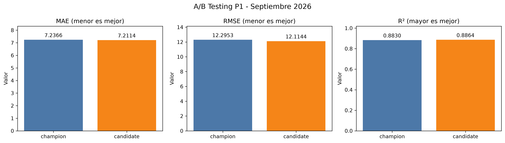

# A/B Testing P1 - Comparación de versiones del modelo de demanda

## 1. Objetivo

El objetivo de esta actividad es comparar el desempeño de dos versiones del modelo de regresión P1, utilizado para predecir la demanda diaria de viajes por estación del sistema MiBici.

Mediante un A/B testing offline, se evalúan ambas versiones sobre el mismo conjunto de datos del periodo actual, utilizando métricas de regresión para determinar cuál presenta un mejor desempeño y recomendar la versión que debería mantenerse vigente.

## 2. Metodología

Para realizar la comparación se utilizaron dos versiones del modelo Random Forest registradas en MLflow Model Registry:

- **Champion (v2):** modelo vigente, utilizado como referencia.
- **Candidate (v3):** modelo alternativo, entrenado con una configuración diferente de hiperparámetros.

Ambos modelos fueron evaluados sobre el conjunto `regression_current.parquet`, correspondiente al periodo del **1 al 30 de septiembre de 2026**, con un total de **10,440 registros de 348 estaciones**.

Se utilizaron las mismas 12 características de entrada y los mismos valores reales de demanda para ambos modelos, garantizando una comparación bajo condiciones equivalentes.

Las métricas seleccionadas fueron:

- **MAE (Mean Absolute Error):** mide el error absoluto promedio de las predicciones. Un valor menor indica mejor desempeño.
- **RMSE (Root Mean Squared Error):** penaliza en mayor medida los errores grandes. Un valor menor indica mejor desempeño.
- **R² (Coeficiente de determinación):** indica qué proporción de la variabilidad de la demanda es explicada por el modelo. Un valor mayor indica mejor desempeño.

Las predicciones negativas se ajustaron a cero, considerando que la demanda de viajes no puede tomar valores negativos.

Finalmente, se calcularon las diferencias absolutas y porcentuales entre ambas versiones. El criterio de selección establecido consiste en recomendar `candidate` cuando obtiene menores valores de MAE y RMSE respecto a `champion`.

Los resultados se almacenaron en archivos CSV y PNG, y se registraron en MLflow para facilitar su consulta y trazabilidad.

## 3. Resultados del A/B Testing

La evaluación se realizó sobre los 10,440 registros correspondientes a septiembre de 2026. Ambos modelos generaron predicciones sobre el mismo conjunto de datos, obteniendo los siguientes resultados:

| Métrica | Champion (v2) | Candidate (v3) | Diferencia porcentual |
|---|---:|---:|---:|
| MAE | 7.2366 | **7.2114** | -0.35% |
| RMSE | 12.2953 | **12.1144** | -1.47% |
| R² | 0.8830 | **0.8864** | +0.39% |

Los resultados muestran que el modelo `candidate` obtuvo un mejor desempeño en las tres métricas evaluadas.

En términos de **MAE**, el error absoluto promedio disminuyó de 7.2366 a 7.2114 viajes, lo que representa una reducción aproximada del 0.35%. Aunque la diferencia es pequeña, indica una mayor precisión promedio en las predicciones del modelo alternativo.

Por su parte, el **RMSE** disminuyó de 12.2953 a 12.1144, equivalente a una mejora del 1.47%. Esta reducción indica que el modelo `candidate` también consiguió disminuir el impacto de los errores de predicción más grandes.

Finalmente, el **R²** aumentó de 0.8830 a 0.8864, lo que indica que el modelo alternativo explica una proporción ligeramente mayor de la variabilidad de la demanda.

En conjunto, las tres métricas favorecen al modelo `candidate`. Si bien las mejoras son pequeñas, los resultados muestran un desempeño consistentemente superior durante el periodo evaluado.

### 3.1. Visualización de resultados

La siguiente gráfica presenta la comparación de MAE, RMSE y R² entre ambas versiones:



La visualización permite observar que las diferencias entre ambos modelos son reducidas, pero favorecen al modelo `candidate` en las tres métricas.

Los valores completos, incluyendo las diferencias absolutas y porcentuales, se encuentran disponibles en:

`reports/ab_testing/comparacion_modelos_p1.csv`

## 4. Registro y trazabilidad en MLflow

Para garantizar la trazabilidad del A/B testing, los resultados se registraron en MLflow Tracking mediante un experimento independiente llamado `mibici-equipo36-ab-testing-p1`.

Este experimento permite consultar las versiones evaluadas, las métricas obtenidas, el periodo de evaluación y los archivos generados durante la comparación.

### 4.1. Información registrada

Se registraron los siguientes elementos:

| Elemento | Información |
|---|---|
| Experimento | `mibici-equipo36-ab-testing-p1` |
| Ejecución | `ab-testing-champion-vs-candidate` |
| Modelo registrado | `mibici-equipo36-p1-demanda` |
| Champion | Versión 2 |
| Candidate | Versión 3 |
| Periodo de evaluación | 2026-09-01 al 2026-09-30 |
| Registros evaluados | 10,440 |
| Modelo recomendado | `candidate` |

Además, se almacenaron las métricas MAE, RMSE y R² de ambas versiones, así como los porcentajes de mejora en MAE y RMSE.

La recomendación se registró mediante la etiqueta `modelo_recomendado`, permitiendo identificar el resultado de la comparación desde la interfaz de MLflow.

### 4.2. Artefactos generados

Como evidencia del experimento, se generaron y almacenaron los siguientes archivos:

- `comparacion_modelos_p1.csv`: contiene las métricas de ambos modelos y sus diferencias absolutas y porcentuales.
- `comparacion_metricas_p1.png`: presenta una visualización comparativa de MAE, RMSE y R².

Ambos archivos se encuentran disponibles en el directorio `reports/ab_testing/` del proyecto y fueron registrados como artefactos de la ejecución en MLflow.

### 4.3. Reproducibilidad

El A/B testing se implementó en el módulo `mibici/modeling/ab_testing_p1.py`, que permite ejecutar nuevamente la evaluación utilizando las versiones registradas en MLflow Model Registry.

La ejecución se realiza mediante el siguiente comando:

```bash
python -m mibici.modeling.ab_testing_p1
```

El programa carga los modelos mediante sus alias `champion` y `candidate`, evalúa ambos sobre el mismo conjunto de datos, genera las métricas y evidencias, y registra los resultados en MLflow.

Este procedimiento permite repetir la comparación y mantener un historial de evaluaciones para futuras versiones del modelo.

## 5. Recomendación final

Con base en los resultados del A/B testing, **se recomienda adoptar el modelo `candidate` (v3) como nueva versión vigente** para la predicción de demanda diaria de viajes por estación.

Durante la evaluación correspondiente a septiembre de 2026, el modelo `candidate` obtuvo mejores resultados que `champion` (v2) en las tres métricas consideradas:

- **MAE:** reducción del 0.35% en el error absoluto promedio.
- **RMSE:** reducción del 1.47% en el error cuadrático medio.
- **R²:** incremento de 0.8830 a 0.8864.

Aunque las mejoras son pequeñas, los resultados muestran una ventaja consistente del modelo alternativo en las métricas evaluadas. En particular, la reducción del RMSE indica una disminución de los errores de predicción más grandes, mientras que la mejora del MAE refleja una mayor precisión promedio.

Por lo tanto, el modelo `candidate` cumple con el criterio de selección establecido y representa la mejor alternativa entre las dos versiones evaluadas para el periodo actual.

Como trabajo futuro, se podría extender la evaluación a meses adicionales para comprobar si esta ventaja se mantiene bajo diferentes patrones de demanda. Sin embargo, considerando los resultados obtenidos en septiembre, **la recomendación actual es promover `candidate` (v3) como nueva versión vigente**.

## 6. Pruebas automatizadas

Para verificar el funcionamiento del A/B testing, se implementaron cinco pruebas automatizadas utilizando `pytest`, disponibles en `tests/test_ab_testing_p1.py`.

Las pruebas permiten validar los cálculos de las métricas, la lógica de selección del modelo recomendado y la integridad de los datos utilizados durante la evaluación.

| Prueba | Descripción | Resultado |
|---|---|---|
| `test_evaluar_modelo` | Verifica el cálculo correcto de MAE, RMSE, R² y las predicciones generadas. | PASSED |
| `test_recomendar_candidate` | Comprueba que se recomiende `candidate` cuando presenta menores valores de MAE y RMSE. | PASSED |
| `test_recomendar_champion` | Verifica que se conserve `champion` cuando el candidato no mejora ambas métricas. | PASSED |
| `test_datos_duplicados` | Comprueba que se detecten registros duplicados por estación y fecha. | PASSED |
| `test_datos_faltantes` | Verifica que se identifiquen valores faltantes en el conjunto de evaluación. | PASSED |

### 6.1. Ejecución de las pruebas

Las pruebas específicas del A/B testing pueden ejecutarse mediante:

```bash
python -m pytest tests/test_ab_testing_p1.py -v
```

**Resultado:** 5 pruebas exitosas.

Adicionalmente, se ejecutó la suite completa de pruebas del repositorio mediante:

```bash
python -m pytest tests/ -v
```

**Resultado:** 136 pruebas exitosas, sin errores ni fallos.

Durante la ejecución se generaron 23 advertencias relacionadas principalmente con dependencias y funciones obsoletas, las cuales no impidieron completar las pruebas.

Estos resultados confirman que las funciones evaluadas del A/B testing se comportan correctamente en los escenarios probados y que su incorporación no produjo fallos en las pruebas existentes del proyecto.
