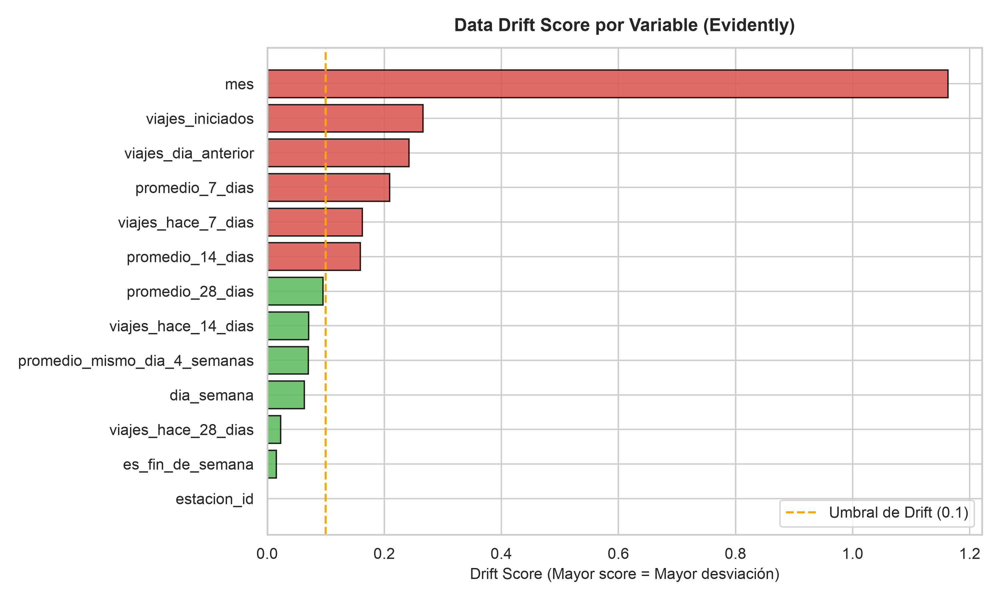
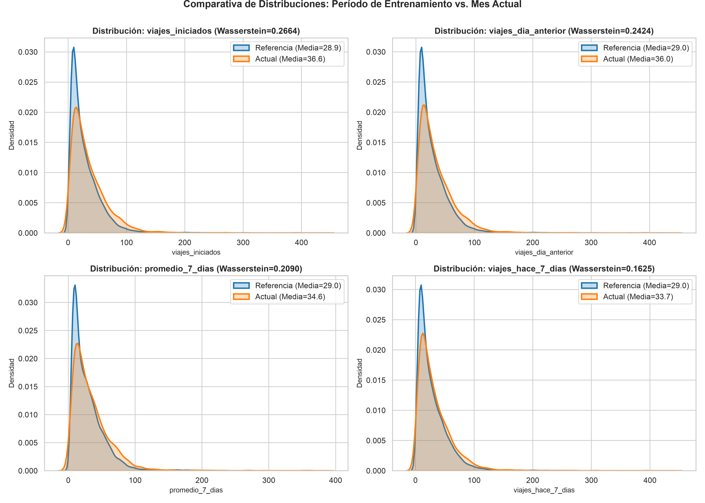
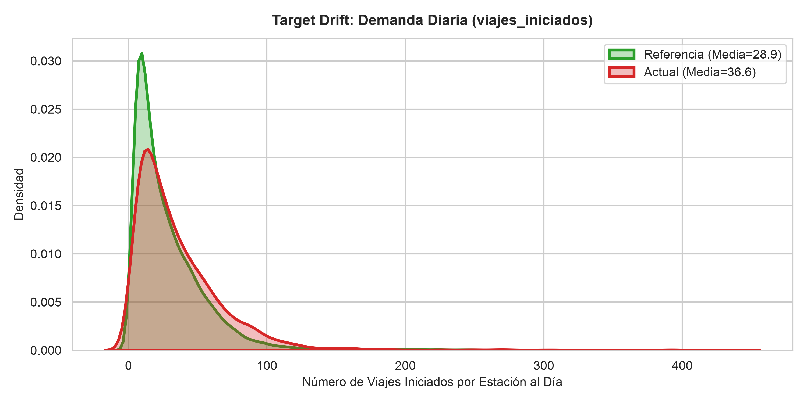
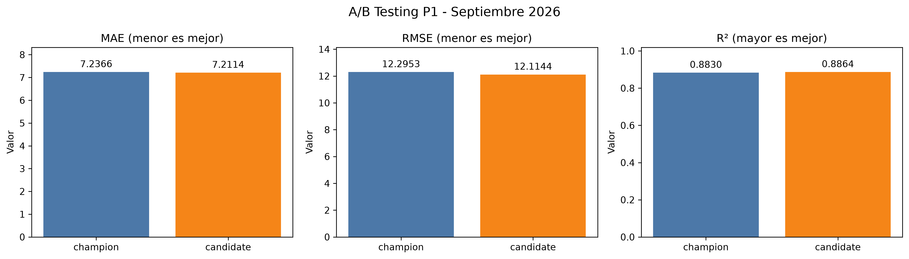

# Monitoreo de Data Drift, A/B Testing y Estrategia de Entrenamiento Continuo

## 1. Resumen

El presente documento consolida la capa de observabilidad, evaluación experimental y gobernanza del ciclo de vida del modelo de regresión para predicción de demanda diaria por estación en el sistema MiBici (`mibici-equipo36-p1-demanda`).

1. **Detección de Drift (Evidently):** Al comparar el conjunto de referencia histórico (`oct-2025` a `ago-2026`, $N = 106,836$) contra el lote de operación reciente (`sep-2026`, $N = 10,440$), se detectó **Target Drift** significativo en `viajes_iniciados` (Wasserstein = `0.2664`) y **Data Drift** en **6 de las 13 variables evaluadas (46.15%)**, concentrado en rezagos de corto plazo (`viajes_dia_anterior`, `promedio_7_dias`, `viajes_hace_7_dias`).
2. **Impacto en Producción y A/B Testing (`v2` vs. `v3`):** El desplazamiento distribucional provocó una degradación observable en el modelo vigente `v2 (@champion)`, cuyo RMSE pasó de `7.8936` en validación histórica a `12.2953` en septiembre 2026. Al ejecutar el A/B testing offline contra el modelo candidato `v3 (@candidate)`, este último obtuvo mejores resultados en las tres métricas (**MAE `-0.35%`**, **RMSE `-1.47%`**, **$R^2$ `+0.39%`**), justificando su promoción como nuevo modelo vigente.
3. **Estrategia de Continuous Training (CT):** Dado que el ajuste de hiperparámetros por sí solo reduce el error marginalmente frente a un cambio de régimen estacional, **se recomienda implementar un pipeline de Continuous Training disparado por umbrales de drift (*Drift-Triggered Retraining*)** que incorpore datos recientes bajo compuertas automatizadas de validación.

---

## 2. Definición de Conjuntos de Datos y Monitoreo con Evidently

Para auditar la estabilidad estadística del sistema en producción ([`mibici/monitoring/drift.py`](../mibici/monitoring/drift.py)), se definieron dos particiones temporales sobre las 348 estaciones activas:

| Conjunto | Período Temporal | Registros | Estaciones | Rol en Observabilidad |
| :--- | :---: | :---: | :---: | :--- |
| **Referencia (`reference`)** | 29-oct-2025 al 31-ago-2026 | 106,836 | 348 | Línea base histórica de entrenamiento y validación del modelo vigente (excluye primeros 28 días por *warmup* de rezagos). |
| **Actual (`current`)** | 01-sep-2026 al 30-sep-2026 | 10,440 | 348 | Lote de operación reciente no visto en entrenamiento; captura el regreso masivo a clases/trabajo y fin del temporal de lluvias en el AMG. |

### 2.1 Resultados Cuantitativos por Variable

| Variable | Tipo | Prueba Estadística | Drift Score | Umbral | Drift Detectado |
| :--- | :---: | :---: | :---: | :---: | :---: |
| `viajes_iniciados` *(Target)* | Continua | Wasserstein (normed) | **0.2664** | 0.10 | **SÍ** |
| `viajes_dia_anterior` | Continua | Wasserstein (normed) | **0.2424** | 0.10 | **SÍ** |
| `promedio_7_dias` | Continua | Wasserstein (normed) | **0.2090** | 0.10 | **SÍ** |
| `viajes_hace_7_dias` | Continua | Wasserstein (normed) | **0.1625** | 0.10 | **SÍ** |
| `promedio_14_dias` | Continua | Wasserstein (normed) | **0.1592** | 0.10 | **SÍ** |
| `mes` | Categórica | Wasserstein (normed) | **1.1629** | 0.10 | **SÍ** |
| `promedio_28_dias` | Continua | Wasserstein (normed) | 0.0955 | 0.10 | No |
| `viajes_hace_14_dias` | Continua | Wasserstein (normed) | 0.0711 | 0.10 | No |
| `promedio_mismo_dia_4_semanas` | Continua | Wasserstein (normed) | 0.0704 | 0.10 | No |
| `dia_semana` | Discreta | Wasserstein (normed) | 0.0632 | 0.10 | No |
| `viajes_hace_28_dias` | Continua | Wasserstein (normed) | 0.0228 | 0.10 | No |
| `es_fin_de_semana` | Binaria | Jensen-Shannon | 0.0158 | 0.10 | No |
| `estacion_id` | Identificador | Wasserstein (normed) | 0.0000 | 0.10 | No |

### 2.2 Interpretación Técnica y de Negocio del Drift

1. **Alerta Crítica de Negocio pese a `dataset_drift_detected: false`:** Aunque la regla global por defecto de Evidently (>50% de columnas afectadas) no activa la bandera general (46.15%), **el desplazamiento recae sobre la variable objetivo y los predictores de mayor importancia en el Random Forest**.
2. **Desplazamiento en Ventanas Cortas (1 a 14 días):** El incremento de viajes en septiembre eleva de inmediato `viajes_dia_anterior` (`0.2424`) y `promedio_7_dias` (`0.2090`), mientras que las ventanas largas (`viajes_hace_28_dias = 0.0228`) amortiguan el choque por inercia histórica.
3. **Integridad Estructural:** `estacion_id` (`0.0000`) y `es_fin_de_semana` (`0.0158`) confirman ausencia de datos corruptos o cambios en la proporción hábil/fin de semana.
4. **Degradación Confirmada del Modelo Vigente:** En validación histórica, el modelo `v2` tenía `MAE = 5.0119` y `RMSE = 7.8936`; al enfrentarse al drift de septiembre, su error escaló a `MAE = 7.2366` (+44.4%) y `RMSE = 12.2953` (+55.8%), confirmando sesgo de subestimación en picos de demanda.

### 2.3 Evidencias Visuales de Evidently

> **Dashboard interactivo y datos:** [`reports/evidently_drift_report.html`](../reports/evidently_drift_report.html) | [`reports/drift_summary.json`](../reports/drift_summary.json) | [`reports/drift_metrics.csv`](../reports/drift_metrics.csv)

---

## 3. Modelo Alternativo y Resultados del A/B Testing (`v2` vs. `v3`)

### 3.1 Versiones Evaluadas en MLflow Model Registry (`mibici-equipo36-p1-demanda`)

| Propiedad | Modelo Control (`@champion`) | Modelo Alternativo (`@candidate`) |
| :--- | :---: | :---: |
| **Versión en Registry** | Versión 2 | Versión 3 |
| **Algoritmo** | `RandomForestRegressor` | `RandomForestRegressor` |
| **Hiperparámetros** | `n_estimators=100`, `max_depth=12`, `min_samples_leaf=5` | `n_estimators=200`, `max_depth=16`, `min_samples_leaf=3` |
| **Desempeño en Validación Histórica** | MAE: `5.0119` / RMSE: `7.8936` | MAE: `5.0248` / RMSE: `7.9380` |
| **Run ID MLflow** | Línea base producción | `0a8b5ea38e0740f9b3c469418427e688` |

Evidencias de entrenamiento y registro en MLflow:
- [Comparación de validación Random Forest](../reports/figures/retraining/p1_comparacion_validacion_random_forest.png)
- [Entrenamiento alternativo en MLflow Tracking](../reports/figures/retraining/p1_retraining_mlflow_tracking.png)
- [Verificación de alias Champion y Candidate](../reports/figures/retraining/p1_verificacion_champion_candidate.png)

### 3.2 Resultados del A/B Testing en Producción (`sep-2026`, $N = 10,440$)

Evaluación ejecutada mediante [`mibici/modeling/ab_testing_p1.py`](../mibici/modeling/ab_testing_p1.py) (experimento `mibici-equipo36-ab-testing-p1`) bajo idénticas condiciones de entrada:

| Métrica | Champion (`v2`) | Candidate (`v3`) | Diferencia Absoluta | Diferencia Porcentual | Versión Superior |
| :--- | :---: | :---: | :---: | :---: | :---: |
| **MAE** *(viajes/día)* | 7.2366 | **7.2114** | -0.0251 | **-0.35%** | `candidate (v3)` |
| **RMSE** *(viajes/día)* | 12.2953 | **12.1144** | -0.1810 | **-1.47%** | `candidate (v3)` |
| **$R^2$** *(Varianza explicada)* | 0.8830 | **0.8864** | +0.0034 | **+0.39%** | `candidate (v3)` |

**Hallazgo Metodológico Clave:** Aunque `v3` parecía ligeramente inferior a `v2` en la partición de validación histórica, su mayor profundidad (`max_depth=16`) y granularidad en hojas (`min_samples_leaf=3`) le permitieron generalizar mejor ante los picos no lineales del nuevo régimen de septiembre, superando a `v2` en las tres métricas. **Se recomienda promover `candidate` (Versión 3) como nuevo `@champion` inmediato.**

---

## 4. Recomendación y Razonamiento sobre Continuous Training (CT)

### 4.1 Veredicto Técnico
**SÍ se recomienda implementar una estrategia de Continuous Training (CT) disparada por umbrales de drift (*Drift-Triggered Retraining*) con actualización de ventana temporal y compuertas automatizadas *Champion/Challenger*.**

### 4.2 Justificación Basada en la Evidencia Empírica

1. **Insuficiencia del ajuste estático de hiperparámetros:** El A/B testing demostró que cambiar hiperparámetros sobre los mismos datos históricos (`v2` $\rightarrow$ `v3`) recupera un **1.47% de RMSE** (`12.2953` $\rightarrow$ `12.1144`), pero el error sigue estando **53% por encima de la línea base histórica (`7.8936`)** porque ninguno de los dos modelos observó datos de septiembre durante su entrenamiento.
2. **Estacionalidad estructural en movilidad urbana:** El sistema MiBici responde a transiciones abruptas de calendario académico, laboral y climático. Esperar ciclos anuales fijos de mantenimiento deja el sistema operando con sesgo de subestimación durante semanas críticas de alta demanda.
3. **Arquitectura de Gobernanza para CT Seguro (Evitando Reentrenamiento a Ciegas):**
   - **Disparador (*Drift Trigger*):** Activar automáticamente el pipeline de reentrenamiento cuando el *Target Drift* (`viajes_iniciados`) o al menos dos predictores de ventana corta (`viajes_dia_anterior`, `promedio_7_dias`) superen una distancia Wasserstein de **`0.15`**, o de forma programada al inicio de cada ciclo escolar/estacional.
   - **Compuerta de Calidad de Datos (*Data Gate*):** Ejecutar la suite de validación ([`mibici/validation/deepchecks_suite.py`](../mibici/validation/deepchecks_suite.py)) sobre la ventana deslizante actualizada antes de entrenar.
   - **Compuerta de Promoción (*Model Gate / A/B Offline*):** Registrar el modelo reentrenado en MLflow como `@candidate` y promoverlo a `@champion` únicamente si supera al modelo vigente en **MAE y RMSE** sobre el lote más reciente de producción ([`mibici/modeling/ab_testing_p1.py`](../mibici/modeling/ab_testing_p1.py)), manteniendo capacidad de *rollback* instantáneo en FastAPI.

---

## 5. Trazabilidad y Artefactos del Equipo

- **Monitoreo Drift:** [`mibici/monitoring/drift.py`](../mibici/monitoring/drift.py) | [`docs/monitoreo_drift.md`](monitoreo_drift.md) | [`reports/drift_summary.json`](../reports/drift_summary.json)
- **Reentrenamiento Candidato:** [`mibici/modeling/retrain_p1.py`](../mibici/modeling/retrain_p1.py) | [`mibici/modeling/register_candidate_p1.py`](../mibici/modeling/register_candidate_p1.py) | [`docs/retraining_p1.md`](retraining_p1.md)
- **A/B Testing:** [`mibici/modeling/ab_testing_p1.py`](../mibici/modeling/ab_testing_p1.py) | [`docs/ab_testing_p1.md`](ab_testing_p1.md) | [`reports/ab_testing/comparacion_modelos_p1.csv`](../reports/ab_testing/comparacion_modelos_p1.csv)
- **Suite de Pruebas Automatizadas:** [`tests/test_monitoring.py`](../tests/test_monitoring.py) | [`tests/test_ab_testing_p1.py`](../tests/test_ab_testing_p1.py) (**136 pruebas exitosas** en `pytest tests/ -v`).
