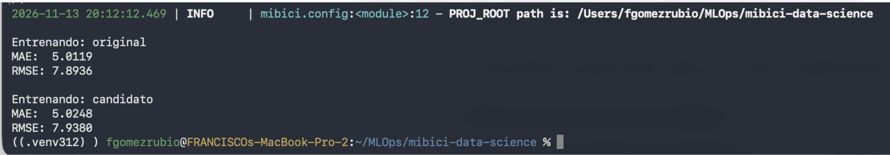
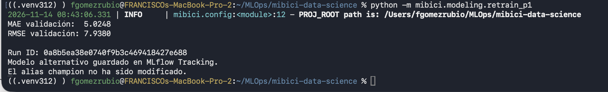
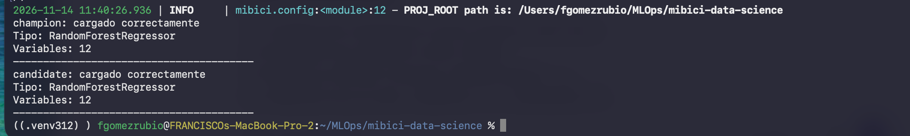

# Reentrenamiento y registro del modelo alternativo P1

## 1. Objetivo

Entrenar y registrar una versión alternativa del modelo de regresión P1 del proyecto MiBici, utilizando Random Forest y MLflow, para permitir su posterior evaluación mediante pruebas A/B.

La versión alternativa se registra con el alias `candidate`, conservando la versión actual identificada como `champion`.

## 2. Configuración de los modelos

| Parámetro | Champion | Candidate |
|---|---:|---:|
| Algoritmo | Random Forest | Random Forest |
| `n_estimators` | 100 | 200 |
| `max_depth` | 12 | 16 |
| `min_samples_leaf` | 5 | 3 |
| Variables predictoras | 12 | 12 |

## 3. Resultados de validación

| Métrica | Configuración original | Configuración alternativa |
|---|---:|---:|
| MAE | 5.0119 | 5.0248 |
| RMSE | 7.8936 | 7.9380 |

La configuración alternativa presenta errores ligeramente superiores en el conjunto de validación. Por lo tanto, no se considera una mejora demostrada respecto a la configuración original.

Sin embargo, se conserva como candidato para su evaluación posterior mediante pruebas A/B.

### Evidencia: comparación de modelos



## 4. Entrenamiento reproducible

El entrenamiento alternativo se implementó en:

`mibici/modeling/retrain_p1.py`

El script realiza las siguientes operaciones:

1. Carga los datos históricos de regresión.
2. Separa los conjuntos de entrenamiento y validación.
3. Entrena un Random Forest con los hiperparámetros alternativos.
4. Calcula MAE y RMSE.
5. Registra los parámetros y las métricas en MLflow.
6. Reentrena el modelo con los datos históricos disponibles hasta agosto de 2026.
7. Guarda el modelo y su firma de entrada en MLflow Tracking.

### Ejecución

```bash
python -m mibici.modeling.retrain_p1
```

### Evidencia: entrenamiento y MLflow Tracking



## 5. Registro en MLflow Model Registry

El registro del modelo alternativo se automatizó mediante:

`mibici/modeling/register_candidate_p1.py`

Este script permite registrar el modelo generado por una corrida de MLflow y asignarle el alias `candidate`.

Antes de crear una versión, comprueba si el modelo correspondiente al Run ID ya se encuentra registrado, evitando duplicados.

### Ejecución

Se requiere configurar `MLFLOW_TRACKING_URI` para apuntar al servidor o base de datos de MLflow correspondiente.

```bash
python -m mibici.modeling.register_candidate_p1 \
  --run-id 0a8b5ea38e0740f9b3c469418427e688
```

### Resultado del registro

| Propiedad | Champion | Candidate |
|---|---|---|
| Nombre registrado | `mibici-equipo36-p1-demanda` | `mibici-equipo36-p1-demanda` |
| Versión | 2 | 3 |
| Alias | `champion` | `candidate` |
| Run ID | `a5c4f6e42f1c415fab2ba1f6afedec76` | `0a8b5ea38e0740f9b3c469418427e688` |

El alias `champion` permaneció asignado a la versión 2 durante todo el procedimiento.

## 6. Verificación de los modelos

Se comprobó que ambas versiones pueden recuperarse desde MLflow Model Registry.

Los dos modelos corresponden a `RandomForestRegressor` y utilizan 12 variables predictoras.

### Evidencia: verificación del Registry



## 7. Integración con pruebas A/B

Las versiones registradas pueden identificarse mediante los siguientes URI:

**Modelo actual:**

`models:/mibici-equipo36-p1-demanda@champion`

**Modelo alternativo:**

`models:/mibici-equipo36-p1-demanda@candidate`

Estos URI permiten recuperar los modelos desde un MLflow Registry accesible.

La evaluación A/B deberá utilizar un conjunto de prueba común, sin reentrenar los modelos durante la comparación.

**Consideración:** el Registry utilizado para las verificaciones se encuentra en un entorno local. Para ejecutar las pruebas desde otro equipo, se requiere acceso al mismo servidor de MLflow y a los artefactos de los modelos, o disponer de un mecanismo de distribución equivalente.

## 8. Conclusión

Se implementó un proceso reproducible de entrenamiento y registro del modelo alternativo P1.

El modelo candidato quedó registrado como versión 3, conservando el modelo actual como `champion` versión 2.

Ambas versiones fueron verificadas y quedaron identificadas para su posterior comparación mediante pruebas A/B.
