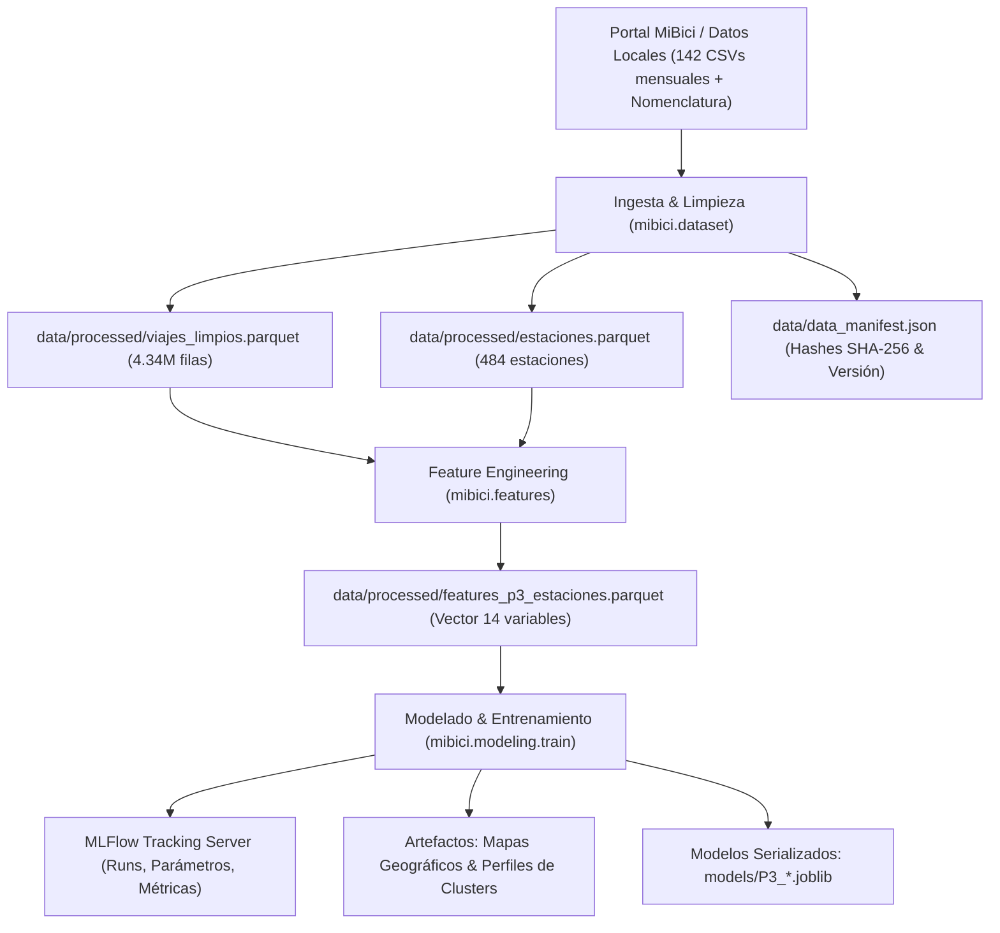

# Propuesta Técnica: Pregunta 3 (P3) - Clustering de Estaciones MiBici

**Proyecto Integrador — MLOps (Equipo 36)**  
**Pregunta:** *¿Qué grupos de estaciones comparten patrones de uso y dónde se ubican en la ciudad?*  
**Tipo de Tarea:** Aprendizaje No Supervisado (Clustering).

---

## 1. Machine Learning Canvas (P3)

| Cuadrante | Descripción Detallada |
| :--- | :--- |
| **Propuesta de Valor** | Agrupar las 484 estaciones del sistema MiBici según su comportamiento operativo y espacial para planear expansiones eficientes de la red y optimizar recursos urbanos. |
| **Usuario Final** | Equipo de Planeación Urbana de la AMG y Coordinación de Expansión de MiBici. |
| **Decisión a Tomar** | 1. Identificar corredores deficitarios vs saturados. 2. Decidir dónde añadir nuevas estaciones o ampliar anclajes. 3. Diseñar estrategias zonales de logística y rebalanceo diferenciadas. |
| **Entidad a Modelar** | Estaciones del sistema de bicicleta pública (484 estaciones activas). |
| **Granularidad & Horizonte** | Agregación anual consolidada (octubre 2025 a septiembre 2026, 4.34 millones de viajes). |
| **Características Clave (Features)** | • **Temporal/Propósito:** % salidas en pico matutino (07-10h), % salidas en pico vespertino (17-20h), % viajes en fin de semana. • **Direccionalidad:** Ratio de flujo neto $\frac{\text{Salidas} - \text{Llegadas}}{\text{Total viajes}}$. • **Intensidad:** Rotación diaria por anclaje $\frac{\text{Viajes diarios}}{\text{Capacidad}}$. • **Espacial:** Latitud y longitud de la estación. |
| **Baseline vs Candidatos** | • **Baseline:** K-Means ($k=3$). • **Candidato:** K-Means ($k=4$) y Gaussian Mixture Models (GMM, $k=4$). |
| **Métricas de Evaluación** | • **Silhouette Score** (cohesión y separación, rango [-1, 1], mayor es mejor). • **Davies-Bouldin Index** (similaridad entre clusters, menor es mejor). • **Calinski-Harabasz Index** (ratio de dispersión inter/intra-cluster, mayor es mejor). |

---

## 2. Diagrama de Arquitectura del Pipeline

---

## 3. Resultados Experimentales en MLFlow

| Run Name | Algoritmo | Clusters ($k$) | Silhouette Score | Davies-Bouldin | Calinski-Harabasz | Conclusión |
| :--- | :--- | :---: | :---: | :---: | :---: | :--- |
| `P3_kmeans_k3_espacial` | K-Means | 3 | 0.2323 | 1.3457 | 117.79 | Baseline inicial. |
| `P3_kmeans_k4_espacial` | K-Means | 4 | **0.2481** | **1.2551** | **130.53** | **Mejor candidato:** Mayor separación y menor solapamiento. |
| `P3_gmm_k4_espacial` | GMM | 4 | 0.2296 | 1.3782 | 113.25 | Clústeres probabilísticos con mayor solapamiento. |

### Interpretación de los Clusters Obtenidos ($k=4$):
1. **Cluster Residencial / Emisor Matutino:** Alta proporción de viajes matutinos, flujo neto positivo (salen más bicis de las que entran en la mañana).
2. **Cluster Laboral / Atractor:** Alta proporción de llegadas en la mañana y salidas en la tarde; flujo neto negativo hacia zonas corporativas/centro.
3. **Cluster Mixto / Alta Rotación:** Estaciones céntricas con alto índice de viajes por anclaje durante todo el día.
4. **Cluster Recreativo / Periférico:** Mayor concentración de uso en fines de semana y duraciones promedio de viaje más prolongadas.

