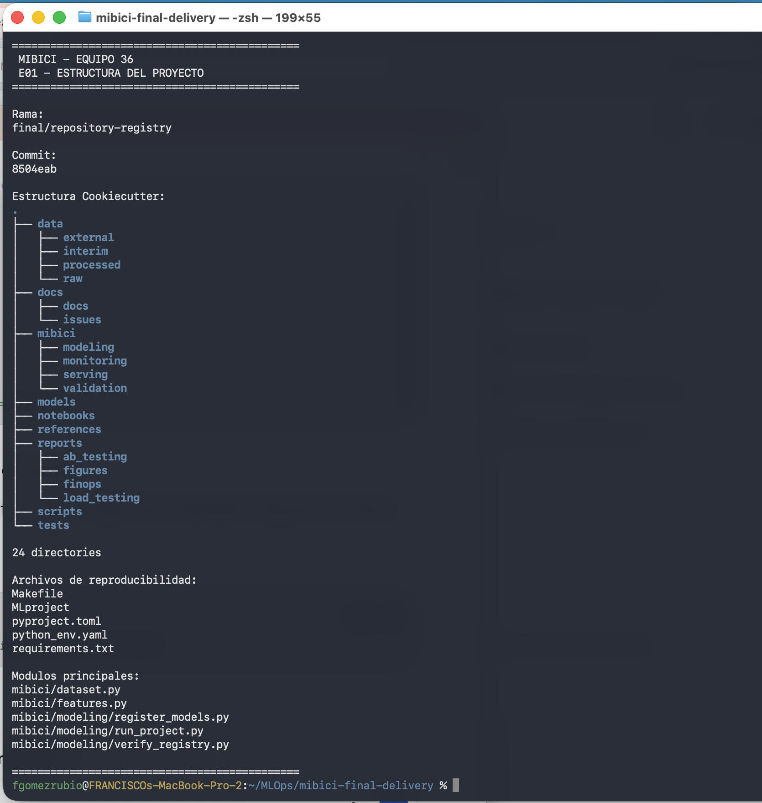
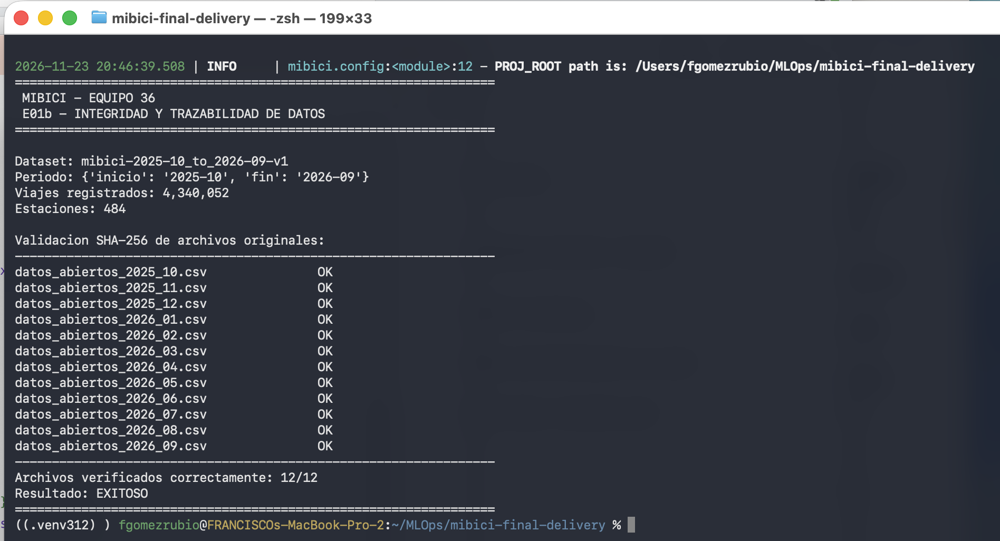
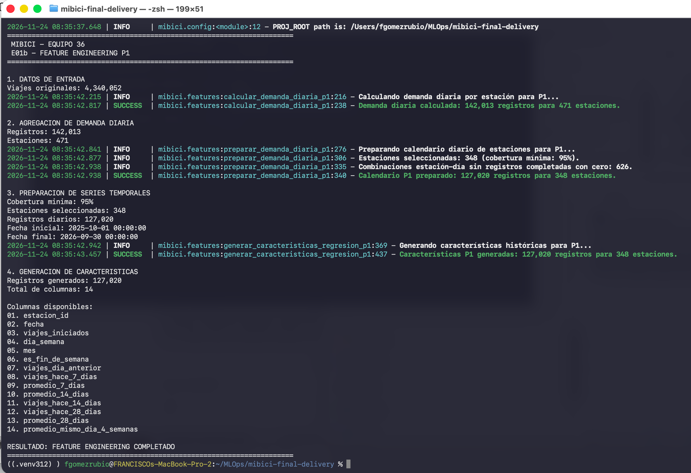
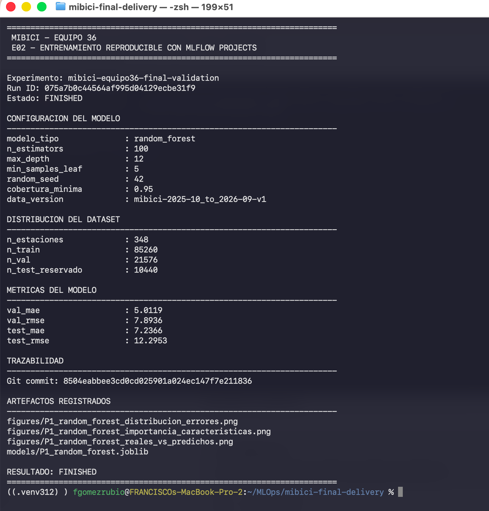
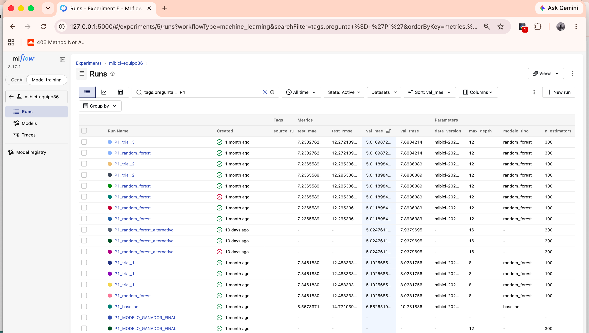
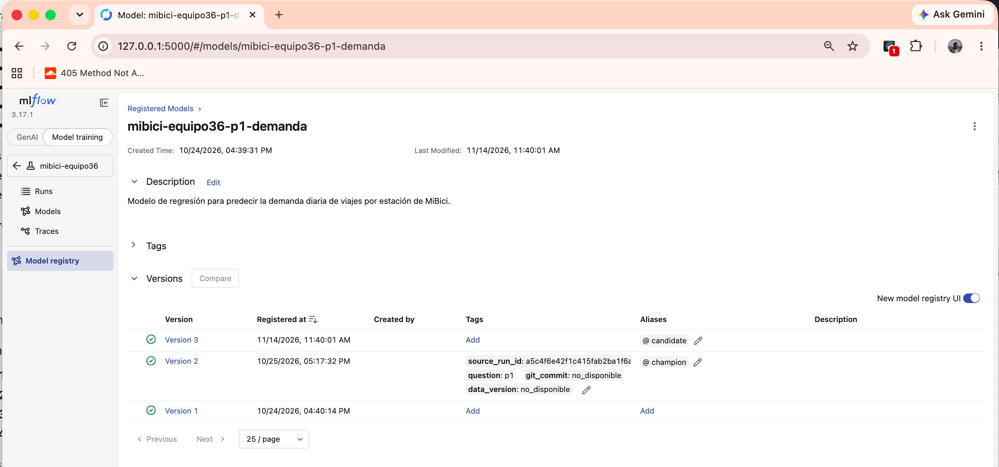
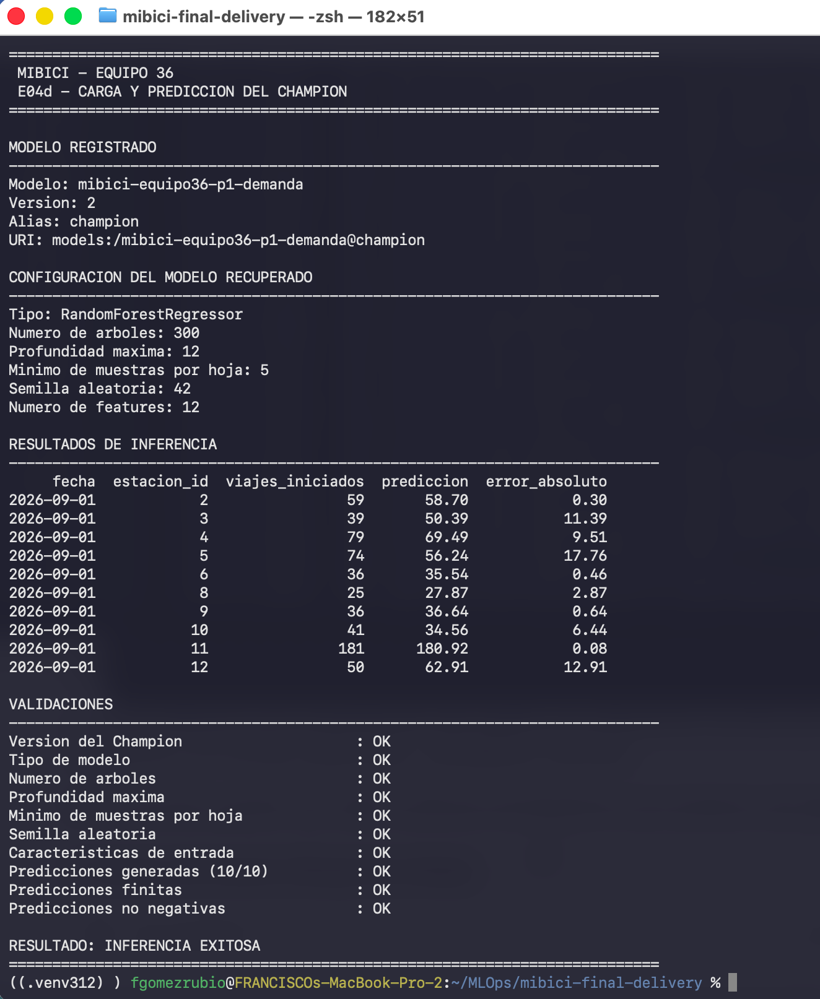

# MiBici — Equipo 36
## Validación final: repositorio, reproducibilidad y registro de modelos

### 1. Objetivo y alcance
Se documenta la validación del pipeline P1 de regresión para predecir la demanda diaria por estación, desde la preparación de datos hasta la recuperación del modelo Champion. La validación se realizó el 24 de noviembre de 2026 en la rama `final/repository-registry`, utilizando Python 3.12 y MLflow 3.17.1.

### 2. Repositorio y ambiente
La estructura del repositorio separa datos, código de preparación y entrenamiento, modelos y reportes. Se utilizó el ambiente `.venv312` y se recopiló evidencia de la revisión de dependencias.



[Ambiente Python](E01a_python_environment.png) · [Dependencias](E01a_dependency_check.png)

### 3. Versionado y reproducibilidad de datos

| Indicador | Resultado |
|---|---:|
| Versión | `mibici-2025-10_to_2026-09-v1` |
| Periodo | Octubre 2025 – septiembre 2026 |
| Archivos de origen | 12 |
| Viajes procesados | 4,340,052 |
| Estaciones reportadas en manifiesto | 484 |
| Estaciones con demanda agregada | 471 |
| Registros de demanda observada | 142,013 |
| Estaciones seleccionadas para P1 | 348 |
| Cobertura mínima en entrenamiento | 95 % |
| Combinaciones estación-día completadas con cero | 626 |
| Registros de calendario diario | 127,020 |

La comparación del manifiesto regenerado con el original reportó manifiestos idénticos. SHA-256 del manifiesto: `f97eb4a3b443512a9a7fb8f9cb25baff4074a6d4e9321656ec80c8d5d0b43652`. Esta comprobación acredita la igualdad del manifiesto, no por sí sola la identidad binaria de todos los archivos de datos.



[Manifiesto](E01b_dataset_manifest.png)

### 4. Feature engineering
Se agregaron viajes por estación y día, se seleccionaron estaciones utilizando exclusivamente la cobertura del periodo de entrenamiento y se completaron días sin salidas registradas con cero. Se generaron 14 columnas, incluyendo fecha, variable objetivo y 12 predictores: identificador de estación, día de semana, mes, fin de semana, retardos de 1, 7, 14 y 28 días, promedios de 7, 14 y 28 días y promedio del mismo día de las cuatro semanas anteriores. Las variables históricas utilizan días anteriores según el contrato de las funciones.



Tras eliminar registros sin historial suficiente, se utilizaron 117,276 observaciones:

| Partición | Periodo | Registros |
|---|---|---:|
| Entrenamiento | 2025-10-29 a 2026-06-30 | 85,260 |
| Validación | 2026-07-01 a 2026-08-31 | 21,576 |
| Prueba | 2026-09-01 a 2026-09-30 | 10,440 |

El modelo final se ajustó nuevamente con entrenamiento y validación antes de evaluar septiembre.

### 5. MLflow Projects
La ingesta y el entrenamiento se ejecutaron mediante los entry points del proyecto. Para la validación final se utilizó un experimento separado:

```bash
export MLFLOW_EXPERIMENT_NAME="mibici-equipo36-final-validation"
python -m mlflow run . \
  --entry-point train --env-manager local \
  --experiment-name mibici-equipo36-final-validation \
  --run-name final-p1-random-forest \
  -P question=p1 -P model=rf \
  -P n_estimators=100 -P max_depth=12 -P min_samples_leaf=5
```

La ejecución terminó en estado FINISHED. El nombre observado del run fue `P1_random_forest`.

- Experimento: 7
- Run ID: `075a7b0c44564af995d04129ecbe31f9`
- Commit registrado: `8504eabbee3cd0cd025901a024ec147f7e211836`
- Semilla: 42
- Duración observada: 39.2 segundos

[Ingesta](E02_mlflow_ingest.png)



### 6. MLflow Tracking y experimentación
Se registraron parámetros, métricas, etiquetas de trazabilidad, tres gráficas y un modelo Joblib. También se almacenó el modelo en formato nativo de MLflow con signature e input_example.

| Configuración | MAE validación | RMSE validación | MAE prueba | RMSE prueba |
|---|---:|---:|---:|---:|
| RF 100, validación final | 5.0119 | 7.8936 | 7.2366 | 12.2953 |
| RF 300, entrenamiento original del Champion | 5.0110 | 7.8904 | 7.2303 | 12.2722 |

El experimento histórico muestra también el baseline de siete días (MAE de validación aproximado de 6.5527). La ejecución final reproduce la configuración histórica de 100 árboles a la precisión observada; no constituye una reproducción exacta del Champion de 300 árboles.



[Experimento final](E03a_mlflow_experiments.png) · [Detalle del run](E03b_mlflow_run_details.png) · [Artefactos](E03c_mlflow_artifacts.png)

### 7. Model Registry y gobernanza

| Modelo | Alias observado | Versión |
|---|---|---:|
| mibici-equipo36-p1-demanda | champion | 2 |
| mibici-equipo36-p1-demanda | candidate | 3 |
| mibici-equipo36-p2-riesgo | champion | 3 |
| mibici-equipo36-p3-grupos | champion | 1 |

No se modificaron los alias ni se promovió el nuevo entrenamiento de validación final.



[Inventario del registro](E04a_mlflow_model_registry.png)

### 8. Linaje del Champion
El modelo P1 versión 2 apunta al packaging run `a5c4f6e42f1c415fab2ba1f6afedec76`, cuyo tag `source_run_id` identifica el entrenamiento original `4dd9959935814b5985dd64b41c1cd2cf` del experimento 5. En este último se recuperaron el commit `e7fc7b580aa5f95c169a75b4a4f22786c8f65580`, la versión de datos y las métricas históricas. El Champion utiliza 300 árboles, profundidad 12, mínimo de cinco muestras por hoja y semilla 42.

[Parámetros y linaje](E04c_01_mlflow_champion_training_parameters.png) · [Métricas y trazabilidad](E04c_02_mlflow_champion_metrics_lineage.png)

### 9. Inferencia del Champion
Se recuperó el modelo mediante `models:/mibici-equipo36-p1-demanda@champion` y se generaron diez predicciones sobre observaciones reales del 1 de septiembre de 2026. Las diez validaciones de versión, configuración, características y predicciones finalizaron correctamente. Se corrigió previamente una comparación de versión entre entero y cadena en el script de comprobación; no fue un fallo del modelo.



### 10. Limitaciones y conclusión
- Los tags históricos `git_commit` y `data_version` de la versión registrada figuraban como `no_disponible`; se recuperaron del entrenamiento original sin modificar el registro.
- MLflow emitió una advertencia sobre columnas enteras y posibles valores faltantes en inferencia. No impidió el entrenamiento; requiere controlar el contrato de entrada.
- Los artefactos se almacenaron localmente. Su disponibilidad en otros equipos requiere acceso al almacenamiento correspondiente o una nueva ejecución.
- La prueba de diez predicciones acredita carga e inferencia local, no disponibilidad de un servicio productivo ni evaluación estadística adicional.

La evidencia confirma la ejecución del pipeline, el seguimiento experimental, el linaje y la recuperación operativa del Champion P1. Las capturas se enumeran en [EVIDENCE_INDEX.md](EVIDENCE_INDEX.md) y la propuesta de exposición se encuentra en [PRESENTATION.md](PRESENTATION.md).
