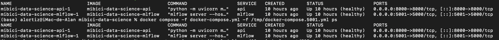
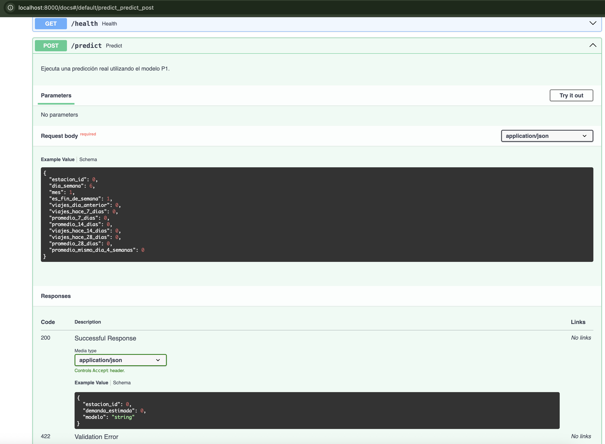
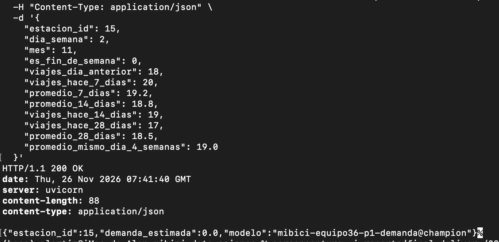
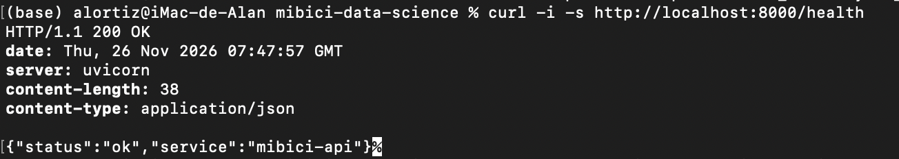

# MiBici — Equipo 36
## Validación final: Despliegue y operación de la API (FastAPI + Docker Compose)

### 1. Objetivo y alcance
Se documenta el despliegue contenerizado y verificación operativa del servicio REST con FastAPI para el modelo de demanda por estación (P1), validado el 26 de noviembre de 2026 en `final/api-deployment` desde `integration/final-delivery`.

### 2. Orquestación y contenedores activos (`E05`)
- **Archivo:** `E05_docker_compose.png` | **Fuentes:** [`docker-compose.yml`](../../../docker-compose.yml), [`Containerfile`](../../../Containerfile).
- **Procedimiento:** `docker compose -f docker-compose.yml -f /tmp/docker-compose.5001.yml up -d` y `ps` (mapeo local `5001:5000` en macOS por conflicto con `ControlCenter`).
- **Resultado:** Contenedores `mibici-data-science-api-1` (`8000->8000`) y `mibici-data-science-mlflow-1` (`5001->5000`) activos en estado `Up (healthy)`.
- **Interpretación:** `depends_on: mlflow: condition: service_healthy` asegura que la API arranque solo cuando MLflow y el Model Registry están disponibles.

### 3. Documentación interactiva de la API (`E06`)
- **Archivo:** `E06_swagger.png` | **Fuente:** [`mibici/api/main.py`](../../../mibici/api/main.py) (`http://localhost:8000/docs`).
- **Resultado:** Swagger UI operativo con esquema Pydantic de 12 variables de entrada para `POST /predict` y respuestas `200 OK` y `422 Validation Error`.

### 4. Petición real y resultado de predicción (`E07`)
- **Archivo:** `E07_predict.png` | **Fuente:** `POST http://localhost:8000/predict`.
- **Resultado:** Respuesta `HTTP/1.1 200 OK` con cuerpo `{"estacion_id":15,"demanda_estimada":0.0,"modelo":"mibici-equipo36-p1-demanda@champion"}`, confirmando la carga dinámica del modelo Champion v2.

### 5. Validación del estado del servicio (`E08`)
- **Archivo:** `E08_health.png` | **Fuente:** `GET http://localhost:8000/health`.
- **Resultado:** Respuesta `HTTP/1.1 200 OK` con `{"status":"ok","service":"mibici-api"}`, validando disponibilidad para `healthcheck` y pruebas de humo en CI/CD.

