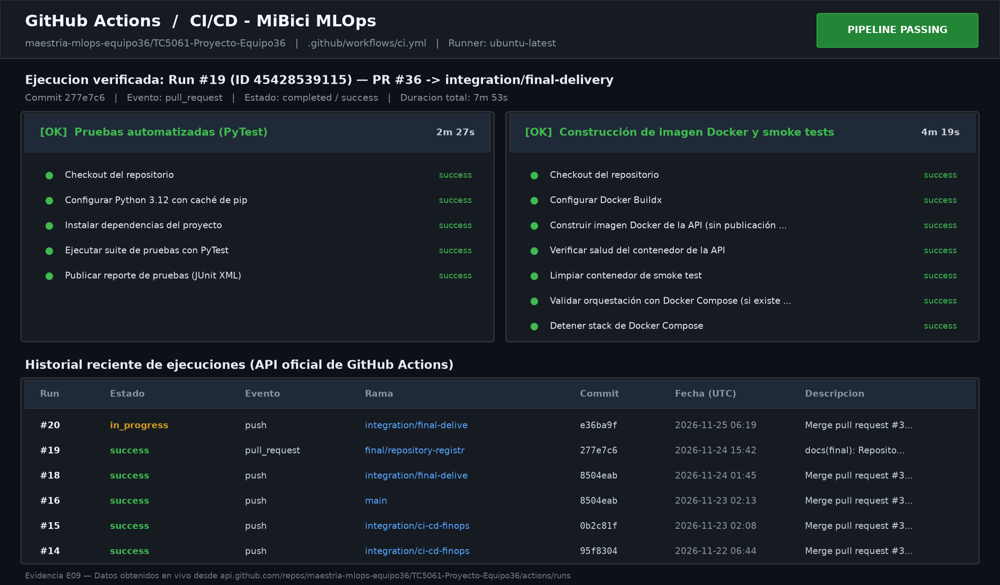
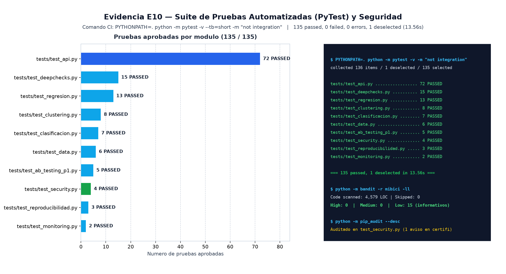
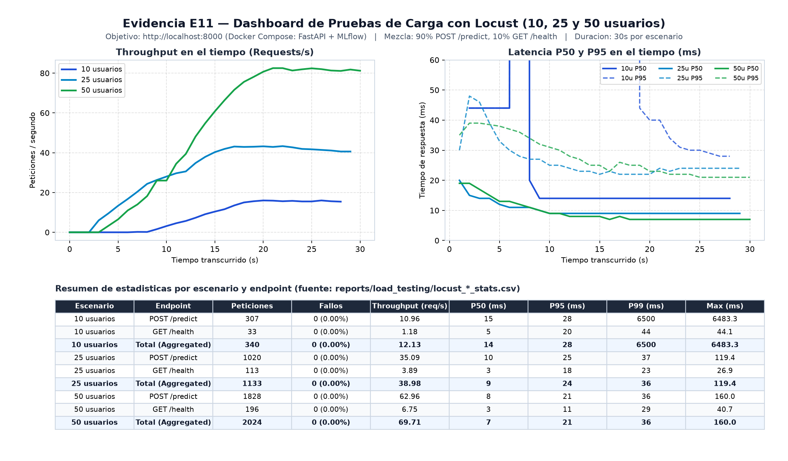
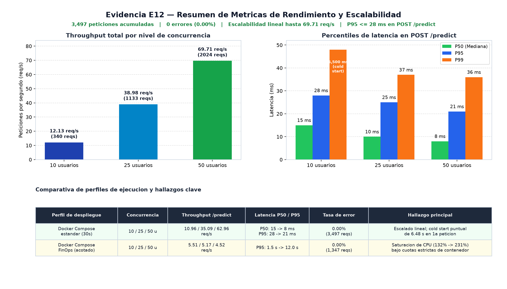

# MiBici — Equipo 36
## Validación final: CI/CD, pruebas automatizadas, seguridad y pruebas de carga

### 1. Objetivo y alcance
Se documenta la validación del pipeline de Integración Continua con GitHub Actions, la suite de pruebas automatizadas con PyTest, las verificaciones de calidad y seguridad (`Bandit` y `pip-audit`) y las pruebas de carga con Locust sobre la API FastAPI de predicción de demanda (P1). La validación se realizó el 24 de noviembre de 2026 en la rama `final/cicd-load-testing`, tomando como base `integration/final-delivery` (commit `e36ba9f`).

---

### 2. Pipeline de CI/CD con GitHub Actions (`E09`)
El flujo de integración continua está definido en [`.github/workflows/ci.yml`](../../../.github/workflows/ci.yml) bajo el nombre **`CI/CD - MiBici MLOps`** sobre `ubuntu-latest`.

- **Disparadores:** `push` en `main`, `integration/**` y `feat/**`; `pull_request` hacia `main` e `integration/**`; y `workflow_dispatch`.
- **Control de concurrencia:** `cancel-in-progress: true` por rama/workflow para evitar ejecuciones duplicadas.
- **Jobs encadenados:**
  1. **`test` (`Pruebas automatizadas (PyTest)`):** Configura Python 3.12 con caché de `pip`, instala `requirements.txt`, ejecuta `PYTHONPATH=. python -m pytest -v --tb=short -m "not integration" --junitxml=reports/junit-pytest.xml` y publica el artefacto `pytest-results`.
  2. **`build-docker` (`Construcción de imagen Docker y smoke tests`):** Depende de `test` (`needs: test`). Construye la imagen desde `Containerfile` con caché GHA (`type=gha`, `push: false`), levanta el contenedor y verifica `GET /health`. Además valida `docker compose config -q`, levanta el stack completo (`MLflow + FastAPI`), verifica ambos endpoints `/health` y realiza la limpieza con `docker compose down -v`.

**Resultado observado (API de GitHub Actions):**
- **Run #19** (`id=45428539115`, `pull_request` desde `final/repository-registry`, commit `277e7c6`): `completed / success` (7m 53s; `test` en 2m 27s y `build-docker` en 4m 19s, todos los pasos en verde).
- **Run #18** (`id=45307335735`, `push` en `integration/final-delivery`, commit `8504eab`): `completed / success` (3m 32s).
- **Run #16** (`id=45098988837`, `push` en `main`, commit `8504eab`): `completed / success`.



---

### 3. Pruebas automatizadas y verificaciones de seguridad (`E10`)
Se ejecutó exactamente el mismo comando definido en el pipeline de CI:

```bash
PYTHONPATH=. python -m pytest -v --tb=short -m "not integration" --junitxml=/tmp/junit-pytest.xml
```

**Resultado obtenido:** **135 pruebas aprobadas, 0 fallidas, 0 errores** (1 prueba marcada `integration` excluida sin servidor MLflow externo) en **13.56 segundos**.

| Módulo de pruebas | Pruebas aprobadas | Cobertura principal |
|---|---:|---|
| `tests/test_api.py` | 72 | Endpoints `/health` y `/predict`, validación Pydantic, rangos y tipos |
| `tests/test_deepchecks.py` | 15 | Integridad de datos, nulos, duplicados, drift y fuga de datos |
| `tests/test_regresion.py` | 13 | Feature engineering P1, sin fuga temporal y reproducibilidad |
| `tests/test_clustering.py` | 8 | Segmentación P3 y estabilidad de perfiles de estaciones |
| `tests/test_clasificacion.py` | 7 | Clasificación de riesgo P2 y reproducibilidad |
| `tests/test_data.py` | 6 | Validación de esquemas, limpieza e ingesta de viajes |
| `tests/test_ab_testing_p1.py` | 5 | Comparación Champion vs. Candidate y reglas de recomendación |
| `tests/test_security.py` | 4 | `.gitignore`, ausencia de secretos hardcodeados, Bandit y `pip-audit` |
| `tests/test_reproducibilidad.py` | 3 | Determinismo del modelo Random Forest P1 y validación de entradas |
| `tests/test_monitoring.py` | 2 | Estructura y generación de reportes de drift con Evidently |
| **Total** | **135** | **100 % aprobadas** |

#### Validaciones de calidad y seguridad
- **Bandit (`python -m bandit -r mibici -ll`):** 4,579 líneas de código analizadas (`0` hallazgos de severidad *High*, `0` *Medium*, `15` *Low* informativos asociados a llamadas controladas de `subprocess` y bloques `try/except`). Reporte histórico en [`reports/bandit_security_report.txt`](../../bandit_security_report.txt).
- **Auditoría de dependencias (`pip-audit`):** Ejecutada automáticamente dentro de `tests/test_security.py::test_pip_audit_dependencies`. Reporte en [`reports/pip_audit_report.txt`](../../pip_audit_report.txt) (1 aviso de actualización de `certifi` a `2026.10.18`).
- **Protección de secretos:** `test_gitignore_protects_sensitive_files` y `test_no_hardcoded_passwords_or_keys` confirman exclusión de `.env`, `.venv`, `data`, `mlflow.db` y `mlartifacts`, y ausencia de credenciales en `mibici/config.py`.



---

### 4. Pruebas de carga con Locust (`E11` y `E12`)
Las pruebas de carga se definieron en [`locustfile.py`](../../../locustfile.py) simulando usuarios concurrentes (`wait_time = between(0.2, 1.0)`) contra `http://localhost:8000` (stack Docker Compose: FastAPI + MLflow), con una mezcla de **90 % `POST /predict`** y **10 % `GET /health`** durante 30 segundos por escenario (`spawn-rate = 5` usuarios/s).

#### Resultados consolidados (`reports/load_testing/locust_*_stats.csv`)

| Escenario | Peticiones totales | Fallos | Throughput total (`req/s`) | Throughput `/predict` (`req/s`) | P50 `/predict` (`ms`) | P95 `/predict` (`ms`) | P99 `/predict` (`ms`) | Máximo (`ms`) |
|---|---:|---:|---:|---:|---:|---:|---:|---:|
| **10 usuarios** | 340 | 0 (0.00 %) | 12.13 | 10.96 | 15 | 28 | 6,500* | 6,483.3 |
| **25 usuarios** | 1,133 | 0 (0.00 %) | 38.98 | 35.09 | 10 | 25 | 37 | 119.4 |
| **50 usuarios** | 2,024 | 0 (0.00 %) | 69.71 | 62.96 | 8 | 21 | 36 | 160.0 |
| **Acumulado** | **3,497** | **0 (0.00 %)** | — | — | — | — | — | — |

*\*Nota sobre el P99 en 10 usuarios:* La primera petición `POST /predict` dispara la carga perezosa (*cold start*) del modelo Champion desde MLflow (~6.48 s). A partir de ese punto, el modelo permanece en memoria y las latencias se estabilizan en `P50 = 8–15 ms` y `P95 = 21–28 ms`.





#### Interpretación y contraste con el perfil FinOps
1. **Disponibilidad total:** 0 errores HTTP en 3,497 peticiones acumuladas bajo carga estándar (y 0 errores adicionales en las 1,347 peticiones del perfil FinOps acotado).
2. **Escalabilidad lineal hasta 50 usuarios:** En el despliegue estándar (`docker-compose.yml`), el throughput creció de **12.13 a 69.71 req/s** manteniendo `P95 <= 28 ms` y `P99 <= 37 ms` tras el calentamiento inicial.
3. **Cuello de botella bajo límites de CPU (perfil FinOps):** En el despliegue con cuotas estrictas de contenedor (`docker-compose.finops.yml`, documentado en [`reports/finops/resumen_consolidado.csv`](../../finops/resumen_consolidado.csv)), la CPU de la API se satura al escalar de 10 a 50 usuarios (`132.6 %` → `231.4 %`), acotando el throughput a `4.52–5.51 req/s` y elevando el P95 hasta `12,000 ms`.
4. **Recomendaciones operativas:**
   - Pre-cargar el modelo Champion en el evento `lifespan`/`startup` de FastAPI para eliminar el *cold start* de 6.48 s en la primera petición.
   - Escalar horizontalmente réplicas de la API (o múltiples workers de Uvicorn) cuando se desplieguen contenedores con límites estrictos de CPU.

---

### 5. Referencias a reportes originales
- Workflow CI/CD: [`.github/workflows/ci.yml`](../../../.github/workflows/ci.yml)
- Suite de pruebas: [`tests/`](../../../tests/)
- Reportes de seguridad: [`reports/bandit_security_report.txt`](../../bandit_security_report.txt), [`reports/pip_audit_report.txt`](../../pip_audit_report.txt)
- Reportes Locust HTML y CSV: [`reports/load_testing/`](../../load_testing/) (`locust_report_10u.html`, `locust_report_25u.html`, `locust_report_50u.html` y `locust_*_stats*.csv`)
- Gráficas originales de carga: [`reports/figures/load_testing/`](../../figures/load_testing/)
- Índice de evidencias de este bloque: [`EVIDENCE_INDEX.md`](EVIDENCE_INDEX.md)
- Propuesta de diapositivas: [`PRESENTATION.md`](PRESENTATION.md)
