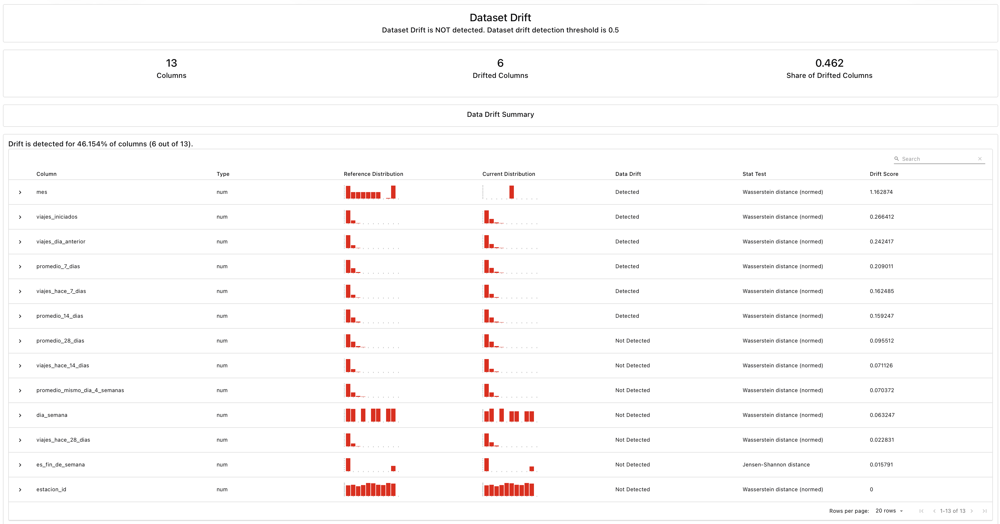
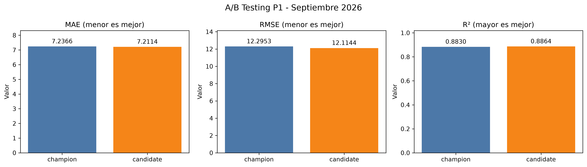
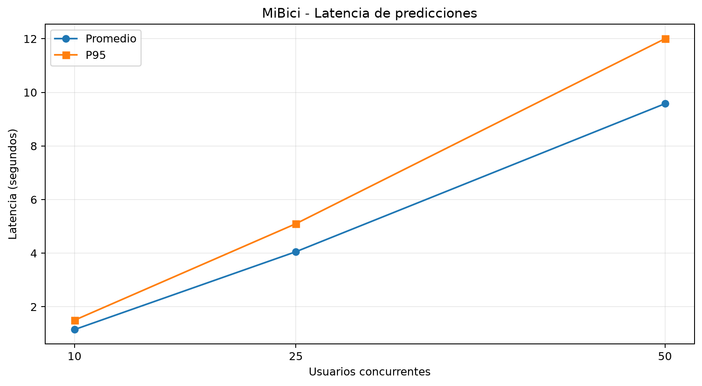
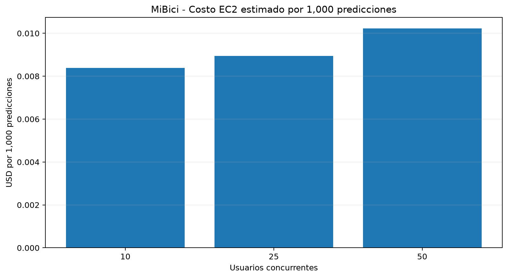
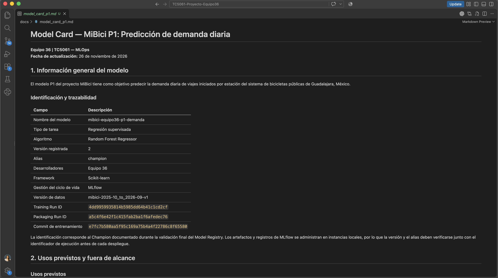

# MiBici — Equipo 36
## Validación final: monitoreo, FinOps y gobernanza

### 1. Objetivo y alcance

Se documenta la validación final de los componentes de monitoreo de datos, comparación de modelos, rendimiento operativo, análisis FinOps y gobernanza del pipeline P1 de regresión para predecir la demanda diaria por estación.

La validación se realizó entre el 25 y el 26 de noviembre de 2026 en la rama `final/monitoring-governance`. Se revisaron los componentes desarrollados durante las entregas anteriores, se corrigieron inconsistencias en el reporte de drift, se ejecutaron pruebas automatizadas y se consolidaron las evidencias y la documentación del ciclo de vida del modelo.

### 2. Monitoreo de Data Drift

Se utilizó Evidently para comparar las distribuciones de las variables predictoras y de la variable objetivo entre un conjunto de referencia y un conjunto de datos recientes.

| Conjunto | Periodo | Observaciones |
|---|---|---:|
| Referencia | 2025-10-29 a 2026-08-31 | 106,836 |
| Actual | 2026-09-01 a 2026-09-30 | 10,440 |

Ambos conjuntos contienen observaciones de las 348 estaciones seleccionadas para P1.

Durante la validación se corrigió la recuperación del umbral estadístico utilizado por Evidently, sustituyendo el valor predeterminado de 0.05 por el valor efectivo de `stattest_threshold`. También se actualizaron las gráficas y la documentación para distinguir correctamente Data Drift y Target Drift.

El reporte se regeneró utilizando Evidently 0.7.23:

```bash
python - <<'PY'
import pandas as pd
from mibici.monitoring.drift import ejecutar_reporte_drift

ref = pd.read_parquet("data/processed/regression_reference.parquet")
curr = pd.read_parquet("data/processed/regression_current.parquet")

resumen = ejecutar_reporte_drift(ref, curr)
print("Dataset drift:", resumen["dataset_drift_detected"])
print("Columnas con drift:", f"{resumen['share_drifted_columns']:.2%}")
PY
```

| Indicador | Resultado |
|---|---:|
| Variables predictoras evaluadas | 12 |
| Variables evaluadas incluyendo el target | 13 |
| Predictores con drift | 5 |
| Variable objetivo con drift | Sí |
| Total de variables con drift | 6 |
| Proporción de variables con drift | 46.15 % |
| Umbral global de dataset drift | 50 % |
| Dataset drift detectado | No |



Las variables que superaron el umbral estadístico fueron:

| Variable | Drift score | Umbral |
|---|---:|---:|
| mes | 1.1629 | 0.10 |
| viajes_iniciados | 0.2664 | 0.10 |
| viajes_dia_anterior | 0.2424 | 0.10 |
| promedio_7_dias | 0.2090 | 0.10 |
| viajes_hace_7_dias | 0.1625 | 0.10 |
| promedio_14_dias | 0.1592 | 0.10 |

Evidently utilizó la distancia de Wasserstein normalizada para las variables numéricas y la distancia de Jensen-Shannon para el indicador de fin de semana.

Aunque no se superó el umbral global de dataset drift, los cambios individuales justifican mantener el seguimiento de las distribuciones. El drift de la variable `mes` es consistente con la diferencia temporal entre los conjuntos comparados, dado que el conjunto actual corresponde exclusivamente a septiembre.

[Reporte Evidently](../../evidently_drift_report.html) · [Métricas de drift](../../drift_metrics.csv) · [Resumen JSON](../../drift_summary.json) · [Gráfica de drift scores](../../figures/drift/evidently_drift_scores.png)

### 3. Target Drift

Se identificó un cambio en la distribución de la variable objetivo `viajes_iniciados`.

| Indicador | Referencia | Actual |
|---|---:|---:|
| Demanda diaria promedio por estación | 28.93 | 36.60 |

La demanda observada aumentó aproximadamente 26.5 % entre ambos conjuntos. El drift score de la variable objetivo fue de 0.2664, superior al umbral de 0.10.

Este resultado constituye evidencia de Target Drift, pero no demuestra por sí mismo la existencia de Concept Drift ni permite atribuir el cambio a una causa específica.

[Distribución de la variable objetivo](../../figures/drift/target_drift_demanda.png) · [Distribución de variables con mayor drift](../../figures/drift/distribucion_variables_top_drift.png) · [Documentación de monitoreo](../../../docs/monitoreo_drift.md)

### 4. A/B Testing y comparación de modelos

Se validaron los resultados de una comparación offline entre dos configuraciones de Random Forest registradas mediante los alias `champion` y `candidate` en una instancia local de MLflow.

Ambos modelos fueron evaluados sobre el mismo conjunto de prueba de septiembre de 2026, compuesto por 10,440 observaciones.

| Parámetro | Champion local | Candidate local |
|---|---:|---:|
| Versión | 2 | 3 |
| n_estimators | 100 | 200 |
| max_depth | 12 | 16 |
| min_samples_leaf | 5 | 3 |
| random_state | 42 | 42 |

| Métrica | Champion local | Candidate local | Variación |
|---|---:|---:|---:|
| MAE | 7.2366 | 7.2114 | -0.35 % |
| RMSE | 12.2953 | 12.1144 | -1.47 % |
| R² | 0.8830 | 0.8864 | +0.39 % |



El Candidate local presentó mejoras marginales en las tres métricas evaluadas.

La implementación recupera las versiones asociadas a los alias, evalúa ambos modelos sobre los mismos datos y registra parámetros, métricas y artefactos de comparación mediante MLflow.

El Champion local de 100 árboles utilizado en este experimento no corresponde al Champion de 300 árboles identificado durante la validación final del Model Registry. Las instancias locales contienen artefactos diferentes, por lo que los resultados no constituyen una comparación directa contra el Champion documentado por el Integrante 1.

No se modificaron los alias ni se promovió el Candidate. Tampoco se realizó una asignación de tráfico real o una evaluación de significancia estadística.

[Resultados de comparación](../../ab_testing/comparacion_modelos_p1.csv) · [Documentación A/B Testing](../../../docs/ab_testing_p1.md) · [Implementación](../../../mibici/modeling/ab_testing_p1.py)

### 5. Monitoreo de recursos y rendimiento operativo

Se consolidaron los resultados de las pruebas de carga y monitoreo de recursos realizadas el 21 de noviembre de 2026 mediante Locust y Docker Compose.

Las pruebas se ejecutaron localmente sobre el servicio de inferencia P1 y el servicio auxiliar de MLflow. Se evaluaron tres escenarios de aproximadamente 90 segundos con 10, 25 y 50 usuarios concurrentes.

| Indicador | 10 usuarios | 25 usuarios | 50 usuarios |
|---|---:|---:|---:|
| Predicciones exitosas | 491 | 454 | 402 |
| Errores | 0 | 0 | 0 |
| Throughput (req/s) | 5.51 | 5.17 | 4.52 |
| Latencia promedio (ms) | 1,150.53 | 4,054.88 | 9,576.66 |
| Latencia P95 (ms) | 1,500 | 5,100 | 12,000 |
| CPU promedio API (%) | 132.60 | 201.20 | 231.43 |
| CPU máxima API (%) | 142.69 | 239.94 | 272.92 |
| Memoria promedio API (MiB) | 423.12 | 438.85 | 448.39 |
| Memoria promedio MLflow (MiB) | 2,358.27 | 2,359.93 | 2,359.73 |
| Memoria total promedio (MiB) | 2,781.39 | 2,798.78 | 2,808.12 |



Se registraron 1,347 predicciones exitosas sin errores. Sin embargo, al incrementar la concurrencia de 10 a 50 usuarios, el throughput disminuyó aproximadamente 18 % y la latencia promedio se multiplicó por 8.32.

El consumo de CPU aumentó con la concurrencia, mientras que la memoria permaneció relativamente estable. Los porcentajes de CPU superiores al 100 % corresponden al uso de múltiples núcleos lógicos en la medición de contenedores.

MLflow representó aproximadamente el 84 % de la memoria total observada, lo que permite identificar una oportunidad de optimización mediante la separación de los servicios de inferencia y seguimiento experimental.

[Resultados consolidados](../../finops/resumen_consolidado.csv) · [Línea base de recursos](../../finops/baseline_resumen.csv) · [Consumo de CPU](../../figures/finops/cpu_por_escenario.png) · [Consumo de memoria](../../figures/finops/memoria_por_escenario.png)

### 6. Análisis FinOps

Se validó la estimación de costos de cómputo utilizando como referencia una instancia Amazon EC2 `t3.xlarge`.

| Parámetro | Valor |
|---|---|
| Instancia | t3.xlarge |
| Región | us-east-1 |
| Sistema operativo | Linux/Unix |
| Capacidad | 4 vCPU y 16 GiB de memoria |
| Tarifa utilizada | USD 0.1664/hora |
| Horas mensuales | 730 |
| Costo mensual estimado | USD 121.47 |

El costo por inferencia se calculó a partir del throughput observado durante las pruebas locales:

- Predicciones por hora = throughput × 3,600.
- Costo mensual = tarifa por hora × 730.
- Costo por inferencia = tarifa por hora / predicciones por hora.
- Costo por 1,000 predicciones = costo por inferencia × 1,000.

| Usuarios | Predicciones/hora estimadas | Costo por inferencia (USD) | Costo por 1,000 predicciones (USD) |
|---|---:|---:|---:|
| 10 | 19,834.99 | 0.000008389 | 0.008389 |
| 25 | 18,595.19 | 0.000008949 | 0.008949 |
| 50 | 16,271.17 | 0.000010227 | 0.010227 |



El costo unitario estimado aumentó aproximadamente 21.9 % entre los escenarios de 10 y 50 usuarios, debido a la reducción del throughput.

La tarifa original de USD 0.1664 por hora se conservó por trazabilidad. El reporte original documenta una tarifa de USD 0.1670 por hora consultada en la página oficial de AWS el 21 de noviembre de 2026.

Las cifras representan una proyección ilustrativa basada en mediciones locales, no costos reales ni resultados de rendimiento validados en AWS. No incluyen almacenamiento, transferencia de datos, impuestos, balanceadores ni posibles cargos adicionales por créditos de CPU.

[Documentación FinOps](../../finops/README.md) · [Estimación de costos](../../finops/costos_aws.csv) · [Evidencias de ejecución](../../finops/EVIDENCIAS.md)

### 7. Oportunidades de optimización

A partir de los resultados de monitoreo y FinOps se identificaron las siguientes oportunidades:

| Área | Hallazgo | Recomendación |
|---|---|---|
| CPU | Incremento de utilización bajo mayor concurrencia | Evaluar workers, límites de CPU y capacidad de procesamiento |
| Memoria | MLflow concentra la mayor parte del consumo | Evaluar la separación de MLflow y la API |
| Latencia | P95 de hasta 12 segundos | Definir objetivos de servicio y concurrencia admisible |
| Throughput | Disminución al incrementar usuarios | Investigar cuellos de botella y alternativas de escalamiento |
| Costos | Incremento del costo unitario estimado | Optimizar el throughput y comparar configuraciones de infraestructura |
| Monitoreo | Cambios en variables individuales y target | Evaluar periódicamente datos recientes y rendimiento predictivo |

Estas recomendaciones constituyen propuestas de mejora derivadas de los resultados observados. No se implementaron optimizaciones adicionales ni se repitieron las pruebas de carga durante la validación final.

### 8. Model Card y gobernanza

Se elaboró una Model Card para el modelo P1 Champion, siguiendo las recomendaciones de Mitchell et al. (2019), Gebru et al. (2021) y la documentación de Hugging Face.

| Campo | Valor |
|---|---|
| Modelo | mibici-equipo36-p1-demanda |
| Versión | 2 |
| Alias | champion |
| Algoritmo | Random Forest Regressor |
| Número de árboles | 300 |
| Profundidad máxima | 12 |
| Mínimo de muestras por hoja | 5 |
| Semilla | 42 |
| MAE de prueba | 7.2303 |
| RMSE de prueba | 12.2722 |

La identificación y las métricas corresponden al Champion documentado durante la validación final del Model Registry.



La Model Card incluye:

- Información general, versiones y trazabilidad del modelo.
- Usos previstos y fuera de alcance.
- Datos, preprocesamiento y particiones temporales.
- Configuración de entrenamiento y métricas de evaluación.
- Despliegue, monitoreo y mantenimiento.
- Resultados operativos y análisis FinOps.
- Consideraciones éticas, riesgos y limitaciones.
- Políticas propuestas de gobernanza y promoción de modelos.
- Referencias académicas y técnicas.

Se verificaron las diez referencias internas del documento, confirmando que todos los archivos referenciados existen en el repositorio.

La documentación distingue los mecanismos implementados de las recomendaciones futuras. El reentrenamiento automático, la promoción automática y el monitoreo continuo en producción no se presentan como funcionalidades implementadas.

[Model Card completa](../../../docs/model_card_p1.md)

### 9. Validación mediante pruebas automatizadas

Se ejecutaron las pruebas correspondientes a los componentes de monitoreo y comparación de modelos:

```bash
python -m pytest tests/test_monitoring.py -v
```

```bash
python -m pytest tests/test_ab_testing_p1.py -v
```

| Componente | Pruebas exitosas | Pruebas fallidas |
|---|---:|---:|
| Monitoreo de drift | 2 | 0 |
| A/B Testing | 5 | 0 |
| Total | 7 | 0 |

Las pruebas de monitoreo finalizaron correctamente, aunque se registraron advertencias durante su ejecución. Estas no impidieron la generación de los reportes.

Las pruebas acreditan el funcionamiento de los componentes evaluados, no constituyen por sí solas una validación integral de todos los servicios del proyecto.

[Pruebas de monitoreo](../../../tests/test_monitoring.py) · [Pruebas de A/B Testing](../../../tests/test_ab_testing_p1.py)

### 10. Limitaciones y conclusión

- El porcentaje global de dataset drift no superó el umbral establecido, aunque se identificaron cambios en cinco variables predictoras y en la variable objetivo.
- El Target Drift observado no demuestra por sí mismo la existencia de Concept Drift.
- El A/B Testing se realizó de manera offline, sin asignación de tráfico real ni evaluación de significancia estadística.
- Los artefactos de las instancias locales de MLflow presentan diferencias. Los resultados del A/B Testing no corresponden a una comparación directa contra el Champion de 300 árboles documentado en la validación final del Model Registry.
- Las pruebas FinOps se ejecutaron localmente. La identidad exacta del artefacto utilizado no se ha reconciliado con el Champion documentado en la validación final.
- Los costos de AWS son estimaciones ilustrativas y requieren validación en la infraestructura objetivo.
- Las políticas de mantenimiento, reentrenamiento y promoción de modelos requieren supervisión y validación antes de su automatización.

La evidencia confirma la disponibilidad y validación de los componentes de monitoreo de datos, comparación offline de modelos, análisis de rendimiento operativo, estimación de costos y documentación de gobernanza.

En conjunto, estos componentes complementan el pipeline de entrenamiento y despliegue, permitiendo evaluar el comportamiento del modelo a lo largo de su ciclo de vida, identificar oportunidades de optimización y establecer criterios para su mantenimiento responsable.

Las capturas se enumeran en [EVIDENCE_INDEX.md](EVIDENCE_INDEX.md) y la propuesta de exposición se encuentra en [PRESENTATION.md](PRESENTATION.md).