# Evidencias de monitoreo y análisis FinOps — MiBici

Equipo 36 · 21 de noviembre de 2026

Las capturas documentan el despliegue, las pruebas de carga y el análisis de recursos. Los datos tabulares oficiales se encuentran en `reports/finops/` y las gráficas comparativas en `reports/figures/finops/`.

## Evidencias de ejecución

### 01. Inicio MLflow y respuesta de salud
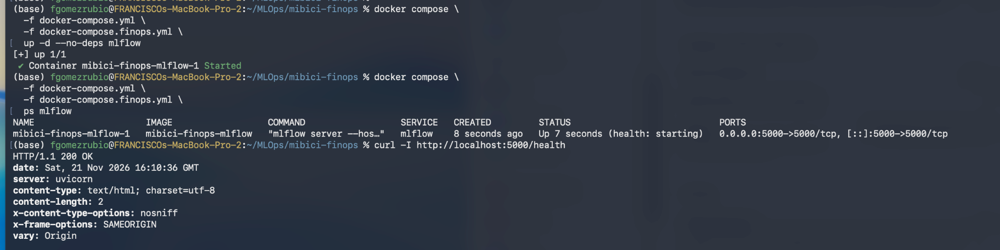

### 02. Contenedores API y MLflow saludables
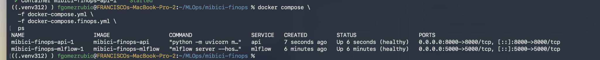

### 03. Predicción real HTTP 200
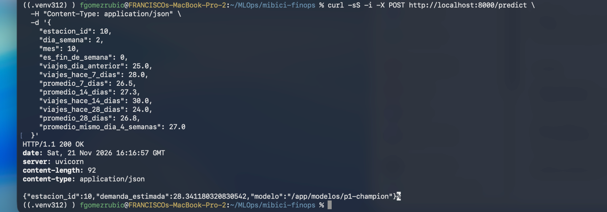

### 04. Ejecución del monitoreo de línea base
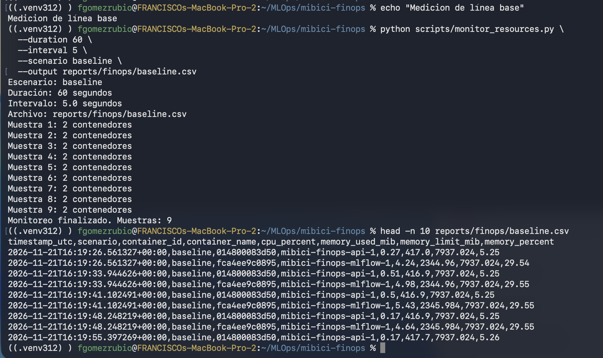

### 05. Resumen de CPU y memoria en línea base
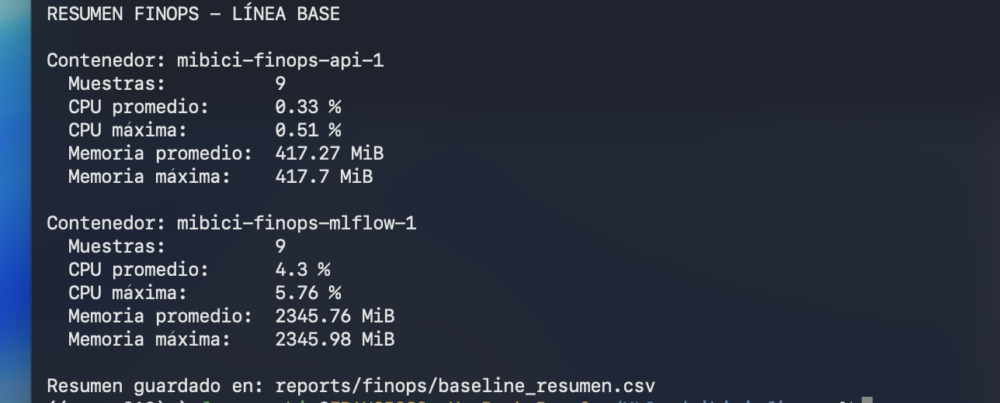

### 06. Resultados de la prueba preliminar de 10 usuarios
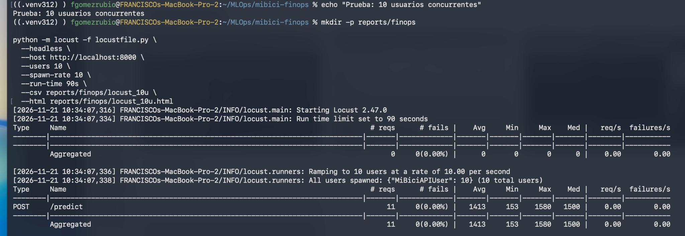

### 07. Inicio de la prueba preliminar de 10 usuarios
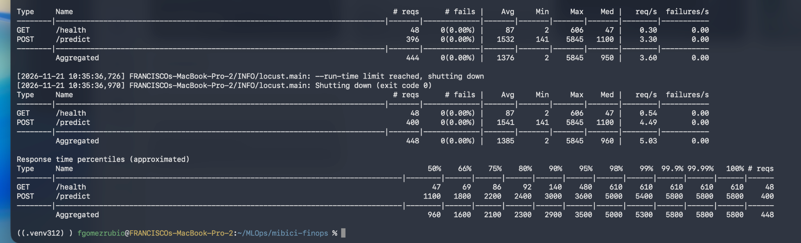

### 08. Inicio de la prueba definitiva de 10 usuarios con monitoreo
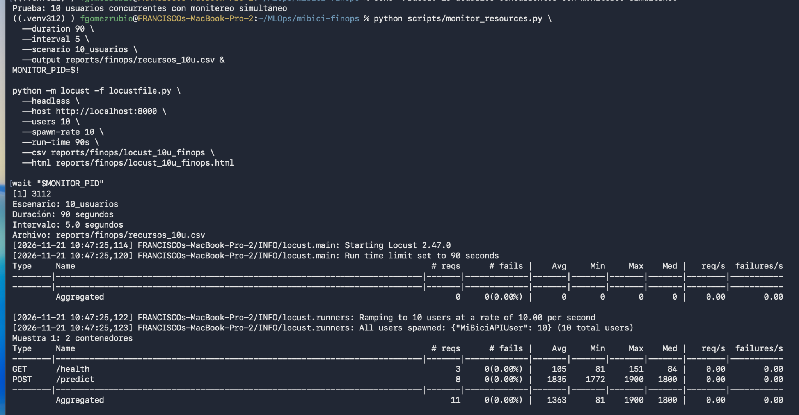

### 09. Resultados de Locust con 10 usuarios
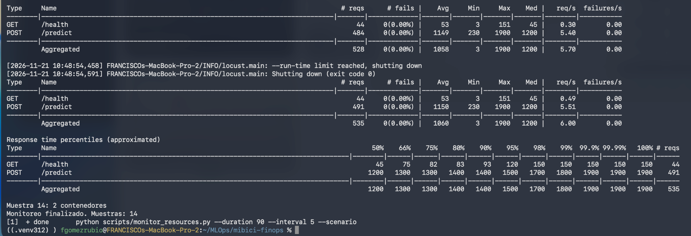

### 10. CPU y memoria con 10 usuarios
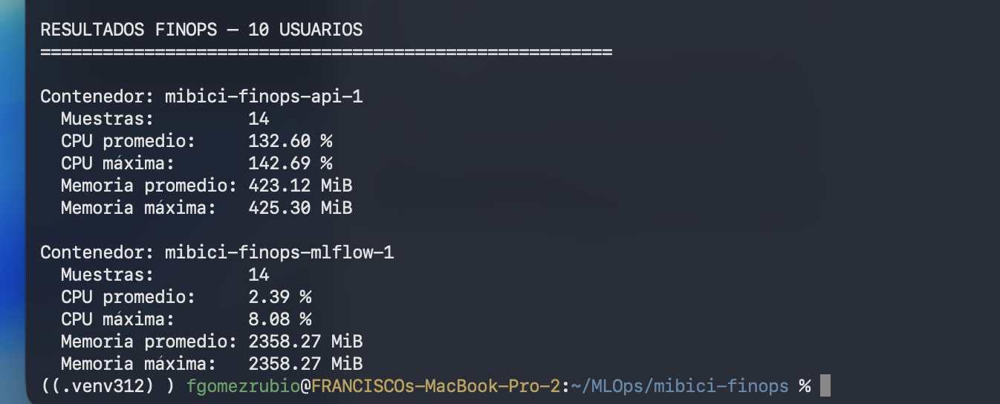

### 11. Inicio de la prueba de 25 usuarios con monitoreo
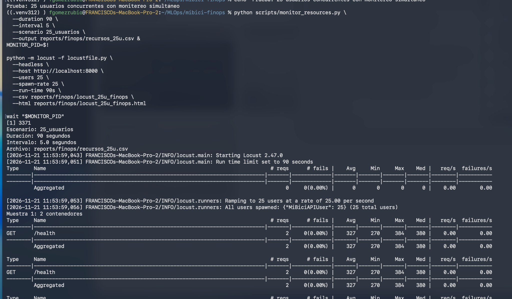

### 12. Resultados de Locust con 25 usuarios
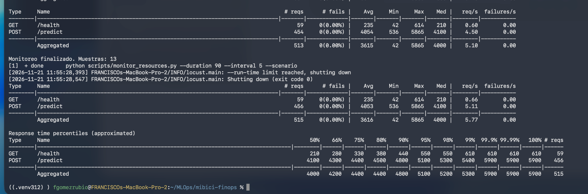

### 13. CPU y memoria con 25 usuarios
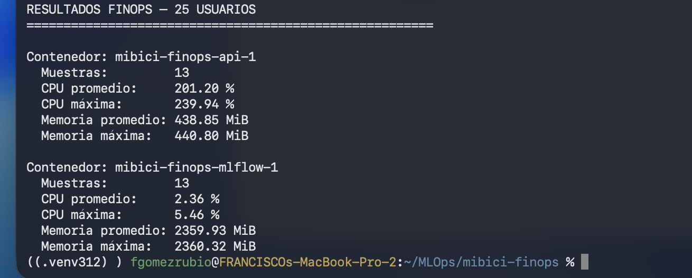

### 14. Inicio de la prueba de 50 usuarios con monitoreo
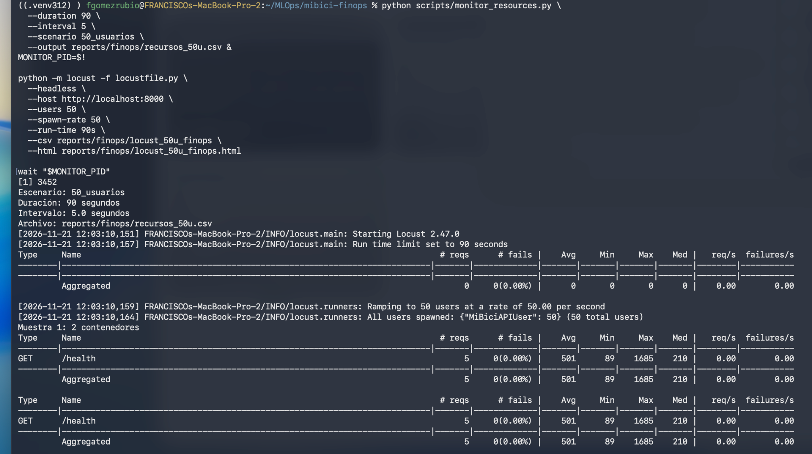

### 15. Resultados de Locust con 50 usuarios
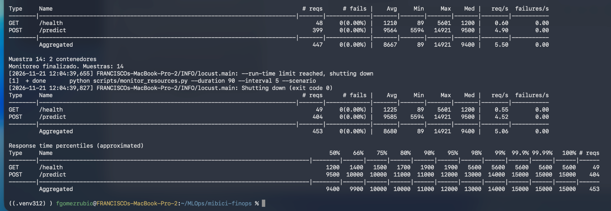

### 16. CPU y memoria con 50 usuarios
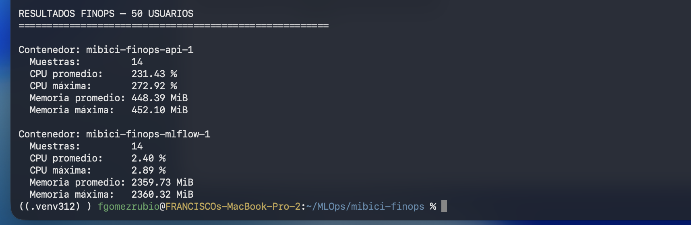

### 17. Resumen consolidado de los tres escenarios
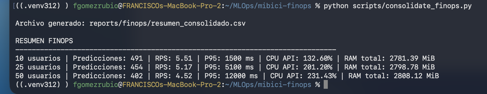

### 18. Estimación de costos EC2 AWS
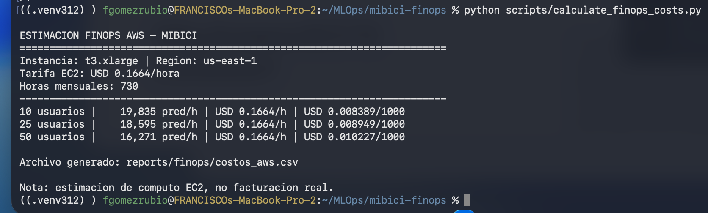

## Consideraciones metodológicas

- Las capturas 06 y 07 corresponden a una ejecución preliminar y no deben utilizarse para calcular las métricas finales.
- Los escenarios definitivos se ejecutaron con 10, 25 y 50 usuarios concurrentes durante 90 segundos, con monitoreo simultáneo de recursos.
- Para resultados oficiales, utilizar `reports/finops/resumen_consolidado.csv`, los archivos `locust_*_finops_stats.csv` y `recursos_*u.csv`.
- La tarifa AWS EC2 empleada es una hipótesis de estimación, no un costo facturado. El cálculo mostrado considera únicamente cómputo EC2; no incluye EBS, red, impuestos ni otros servicios.
- La API utiliza un modelo cargado desde un montaje local de solo lectura para estas pruebas; el servicio MLflow se ejecuta en paralelo.
