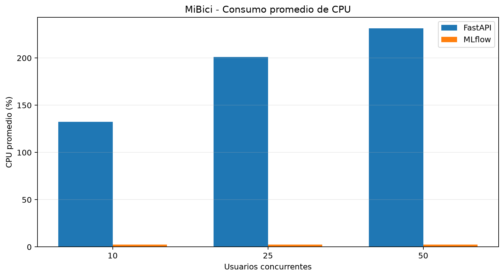
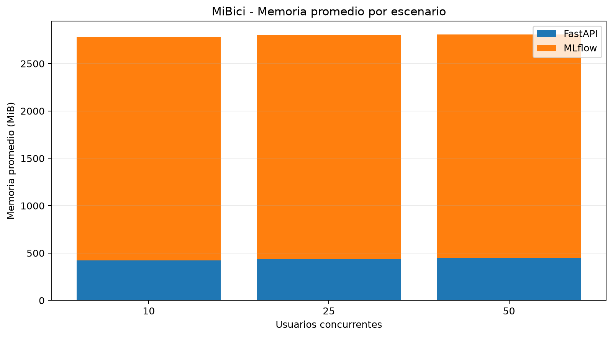
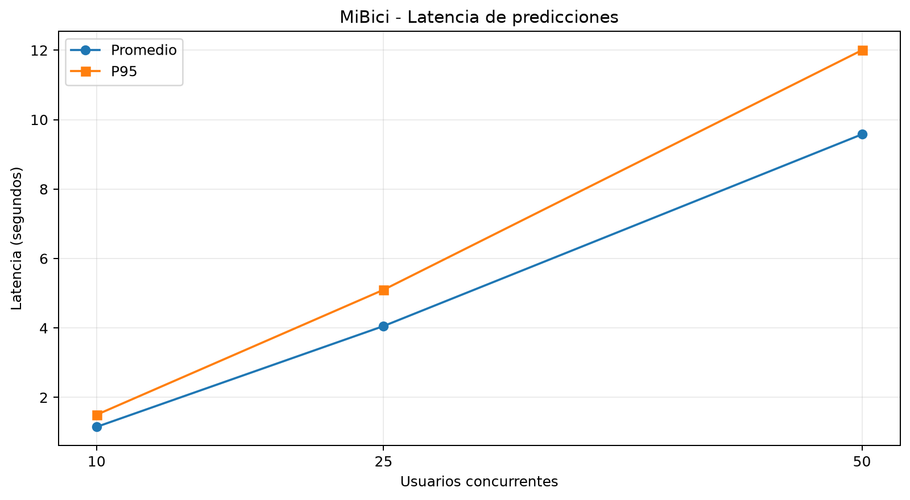
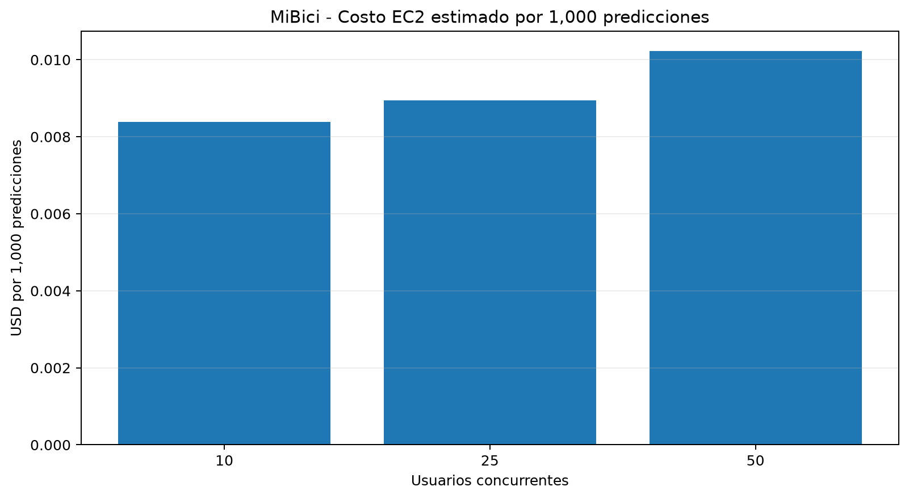

# Monitoreo de recursos, pruebas de carga y análisis FinOps — MiBici

**Equipo 36 | 21 de noviembre de 2026**

## 1. Objetivo y alcance

Evaluar el comportamiento operativo del servicio de predicción de demanda diaria por estación del proyecto MiBici mediante monitoreo de recursos, pruebas de carga y una estimación de costos de cómputo en AWS. El análisis busca identificar relaciones entre concurrencia, capacidad de respuesta, consumo de CPU y memoria, y costo estimado por predicción.

Las pruebas se ejecutaron **localmente con Docker Compose**, no en una instancia EC2 real. Por tanto, las métricas de rendimiento son observaciones del entorno local y los costos de AWS son una **proyección ilustrativa**, no cargos reales ni una medición de rendimiento en AWS.

## 2. Entorno evaluado

- Servicio de inferencia: API con endpoint `POST /predict`.
- Servicio auxiliar: MLflow.
- Orquestación local: Docker Compose.
- Pruebas de carga: Locust.
- Monitoreo de contenedores: `scripts/monitor_resources.py`.
- Procesamiento: `scripts/consolidate_finops.py`, `scripts/calculate_finops_costs.py` y `scripts/plot_finops.py`.
- Modelo: P1 champion, montado en el contenedor API **en modo de solo lectura**.

Se verificó una predicción real con respuesta HTTP 200, con valor `demanda_estimada = 28.34118`. La configuración adicional `docker-compose.finops.yml` permite definir la ruta del modelo mediante la variable de entorno `MIBICI_MODEL_ARTIFACTS_PATH`, sin fijar rutas personales en el repositorio.

## 3. Metodología

### 3.1. Línea base

Se monitorearon los contenedores API y MLflow durante aproximadamente 60 segundos, antes de aplicar carga de usuarios. Los promedios registrados fueron:

| Servicio | CPU promedio | Memoria promedio |
|---|---:|---:|
| API | 0.33 % | 417.27 MiB |
| MLflow | 4.30 % | 2,345.76 MiB |

Fuente: [`baseline_resumen.csv`](baseline_resumen.csv). Estos valores describen el entorno local observado y no deben extrapolarse directamente a AWS.

### 3.2. Escenarios de carga

Se realizaron tres pruebas definitivas de aproximadamente **90 segundos por escenario**, con **10, 25 y 50 usuarios concurrentes**. Locust generó solicitudes de predicción mientras se registraba el consumo de recursos de los contenedores. También hubo una prueba preliminar de 10 usuarios, conservada únicamente como evidencia de preparación y no utilizada en el resumen comparativo final.

Los datos canónicos son los archivos `locust_*_finops_stats.csv`, `recursos_*u.csv` y [`resumen_consolidado.csv`](resumen_consolidado.csv). Las capturas de pantalla ilustran la ejecución, pero pueden reflejar cortes temporales diferentes de los CSV finales.

## 4. Resultados comparativos

| Indicador | 10 usuarios | 25 usuarios | 50 usuarios |
|---|---:|---:|---:|
| Predicciones exitosas | 491 | 454 | 402 |
| Errores | 0 | 0 | 0 |
| Throughput de predicción (req/s) | 5.51 | 5.17 | 4.52 |
| Latencia promedio (ms) | 1,150.53 | 4,054.88 | 9,576.66 |
| Latencia P95 (ms) | 1,500 | 5,100 | 12,000 |
| CPU promedio API (%) | 132.60 | 201.20 | 231.43 |
| CPU máxima API (%) | 142.69 | 239.94 | 272.92 |
| Memoria promedio API (MiB) | 423.12 | 438.85 | 448.39 |
| Memoria promedio MLflow (MiB) | 2,358.27 | 2,359.93 | 2,359.73 |
| Memoria total promedio (MiB) | 2,781.39 | 2,798.78 | 2,808.12 |

**Interpretación.** Al pasar de 10 a 50 usuarios, el throughput disminuyó aproximadamente 18 %, mientras que la latencia promedio se multiplicó por 8.32. No se observaron errores en los registros consolidados; sin embargo, la ausencia de errores no implica que el servicio mantenga una latencia aceptable bajo mayor concurrencia.

Los porcentajes de CPU por encima del 100 % son posibles en la medición de contenedores cuando se utiliza más de un núcleo lógico; no representan por sí solos un error de captura.

### 4.1. Consumo de CPU



La CPU de la API aumenta con la concurrencia. Conviene investigar la capacidad de procesamiento y la configuración de workers antes de plantear escalamiento.

### 4.2. Consumo de memoria



La memoria total promedio se mantuvo cercana a 2.8 GiB. MLflow representó la mayor parte de la memoria observada, por lo que debe distinguirse el costo operativo de MLflow del costo estrictamente asociado a inferencia.

### 4.3. Latencia



La latencia promedio y el percentil 95 aumentaron notablemente al elevar la concurrencia. Esto indica degradación de la experiencia de respuesta en el entorno probado.

## 5. Estimación de costos AWS EC2

Se utilizó un escenario hipotético de **una instancia Amazon EC2 `t3.xlarge`**, sistema Linux/Unix, región **US East (N. Virginia), `us-east-1`**, con funcionamiento continuo de **730 horas mensuales**.

### 5.1. Tarifa utilizada en el cálculo original

El archivo [`costos_aws.csv`](costos_aws.csv) fue generado con una tarifa de **USD 0.1664 por hora**, que produce **USD 121.47 al mes** (0.1664 × 730 = 121.472, redondeado). Esta tarifa se conserva para mantener trazabilidad con los resultados calculados originalmente.

**Verificación de fuente (21 de noviembre de 2026):** la [página oficial de instancias T3 de AWS](https://aws.amazon.com/ec2/instance-types/t3/) consultada para este documento muestra **USD 0.1670 por hora** para `t3.xlarge` Linux/Unix en US East (N. Virginia), con **4 vCPU y 16 GiB de memoria**. Por lo tanto, **USD 0.1664/h no coincide exactamente con la tarifa visible en esa fuente**. Antes de utilizar la proyección para decisiones financieras, debe actualizarse el parámetro del script, regenerarse `costos_aws.csv` y documentarse la fecha de consulta.

Además, las instancias T3 emplean créditos de CPU; un uso sostenido por encima de su línea base puede generar cargos adicionales en modo Unlimited. Por ello, la equivalencia entre los porcentajes de CPU de Docker local y el costo de ejecución real en T3 **no está validada**.

### 5.2. Resultados del modelo original

| Usuarios | Predicciones/h estimadas | Costo estimado por 1,000 predicciones (USD) |
|---|---:|---:|
| 10 | 19,834.99 | 0.008389 |
| 25 | 18,595.19 | 0.008949 |
| 50 | 16,271.17 | 0.010227 |



**Cálculo:**

- Predicciones/hora estimadas = throughput (predicciones/segundo) × 3,600.
- Costo mensual estimado de cómputo = tarifa EC2 por hora × 730.
- Costo por 1,000 predicciones = tarifa EC2 por hora ÷ predicciones/hora estimadas × 1,000.

El costo unitario aumenta cuando el throughput disminuye. Esta proyección supone que el throughput observado en pruebas locales se mantendría durante una hora y que la capacidad de una instancia EC2 seleccionada sería equivalente, **supuestos que no se verificaron experimentalmente**.

### 5.3. Exclusiones

No se incluyen almacenamiento EBS, transferencia de datos, direcciones IPv4 públicas, balanceadores, observabilidad administrada, impuestos, licencias ni cargos por créditos de CPU T3. Tampoco se estimó una arquitectura de alta disponibilidad. Para un presupuesto real debe utilizarse [AWS Pricing Calculator](https://calculator.aws/) y validar el desempeño mediante pruebas en la infraestructura objetivo.

## 6. Reproducibilidad

### 6.1. Configuración portable del modelo

El archivo `docker-compose.finops.yml` define el montaje del modelo en modo de solo lectura. Cada colaborador debe establecer la variable `MIBICI_MODEL_ARTIFACTS_PATH` con una **ruta absoluta local** al directorio de artefactos que contiene `MLmodel`.

Ejemplo de validación desde la raíz del repositorio:

```bash
export MIBICI_MODEL_ARTIFACTS_PATH="/ruta/local/al/modelo/artifacts"
docker compose -f docker-compose.yml -f docker-compose.finops.yml config --quiet
```

La ruta es un marcador de posición: debe sustituirse por una ubicación existente. No se recomienda publicar rutas personales ni artefactos de modelos dentro del PR.

### 6.2. Herramientas y generación de reportes

Los scripts empleados están ubicados en `scripts/`:

- `monitor_resources.py`: captura CPU y memoria de los contenedores; dispone de argumentos de línea de comandos.
- `consolidate_finops.py`: consolida resultados de Locust y monitoreo.
- `calculate_finops_costs.py`: estima costos de EC2 a partir de los resultados.
- `plot_finops.py`: genera las gráficas comparativas.

Para consultar las opciones del monitor y del cálculo de costos:

```bash
python scripts/monitor_resources.py --help
python scripts/calculate_finops_costs.py --help
```

Los comandos completos de ejecución de cada escenario deben recuperarse del historial de pruebas o verificarse contra el código de los scripts antes de declararlos como una receta reproducible. No se fijan aquí argumentos no confirmados.

## 7. Hallazgos y recomendaciones

1. **Capacidad:** evaluar el punto de saturación de la API y analizar workers, límites de CPU y alternativas de escalamiento.
2. **Latencia:** definir un objetivo de servicio (por ejemplo, P95 máximo) y repetir pruebas para determinar la concurrencia admisible.
3. **Memoria:** revisar si MLflow debe ejecutarse en el mismo entorno operativo que la API durante las pruebas o el despliegue.
4. **Costos:** comparar tipos de instancia y modalidades de contratación, incluyendo el comportamiento de créditos de CPU T3.
5. **Validación:** repetir los escenarios en AWS antes de usar las estimaciones como base de una decisión de capacidad o presupuesto.
6. **Observabilidad:** mantener series históricas de CPU, memoria, latencia, throughput y errores para detectar cambios entre versiones.

## 8. Evidencias y archivos de resultados

- [Índice de 18 capturas de ejecución](EVIDENCIAS.md).
- [Resumen consolidado de rendimiento](resumen_consolidado.csv).
- [Estimación original de costos AWS](costos_aws.csv).
- [Línea base de recursos](baseline_resumen.csv).
- Resultados definitivos de Locust: `locust_10u_finops_stats.csv`, `locust_25u_finops_stats.csv` y `locust_50u_finops_stats.csv`.
- Monitoreo de recursos: `recursos_10u.csv`, `recursos_25u.csv` y `recursos_50u.csv`.
- Gráficas: `reports/figures/finops/` (rutas relativas incluidas en este documento).

## 9. Referencias

Amazon Web Services. (s. f.). *Amazon EC2 T3 instances*. Recuperado el 21 de noviembre de 2026, de https://aws.amazon.com/ec2/instance-types/t3/

Amazon Web Services. (s. f.). *Amazon EC2 On-Demand pricing*. Recuperado el 21 de noviembre de 2026, de https://aws.amazon.com/ec2/pricing/on-demand/

Amazon Web Services. (s. f.). *AWS Pricing Calculator*. https://calculator.aws/

---

**Nota de trazabilidad:** los valores numéricos de rendimiento y costos provienen de los archivos CSV generados durante el ejercicio. La consulta de AWS se utilizó para contextualizar el tipo de instancia y contrastar la tarifa, no para afirmar que se realizó un despliegue o una facturación en AWS.
